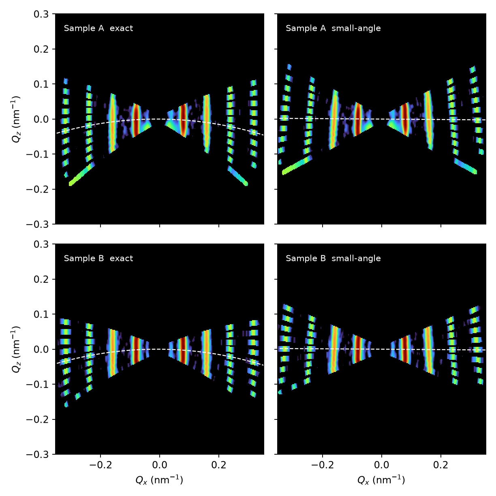
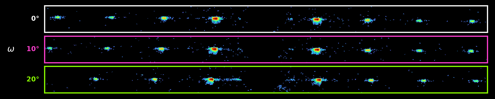
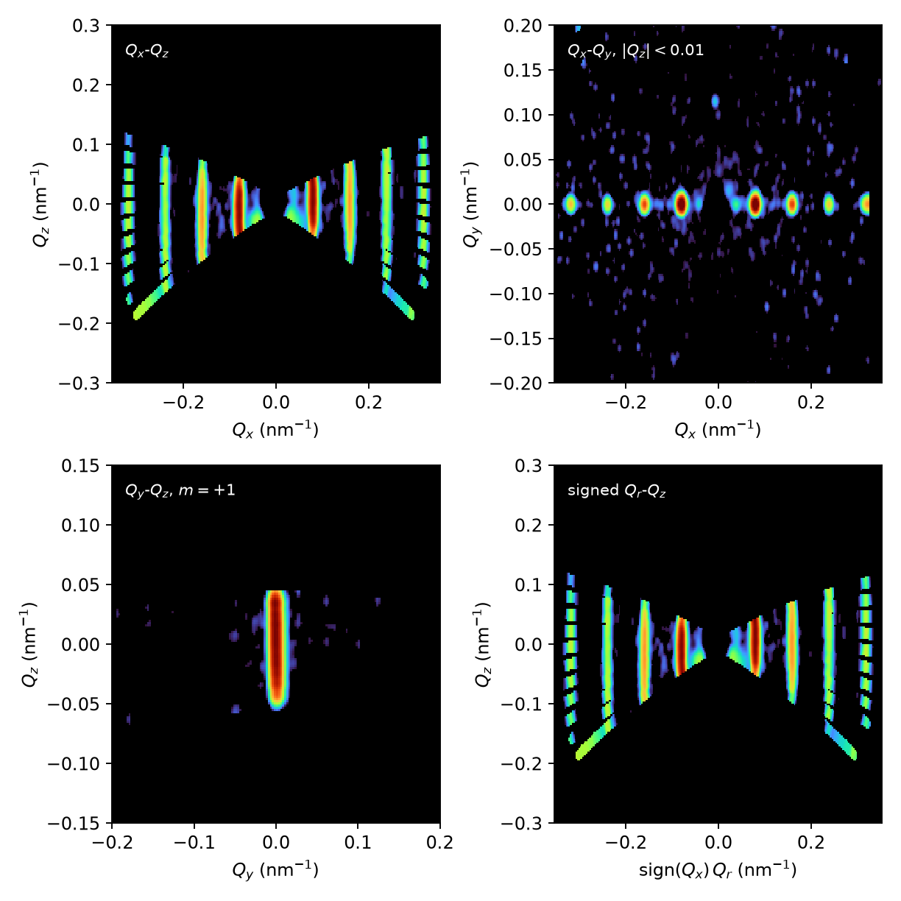
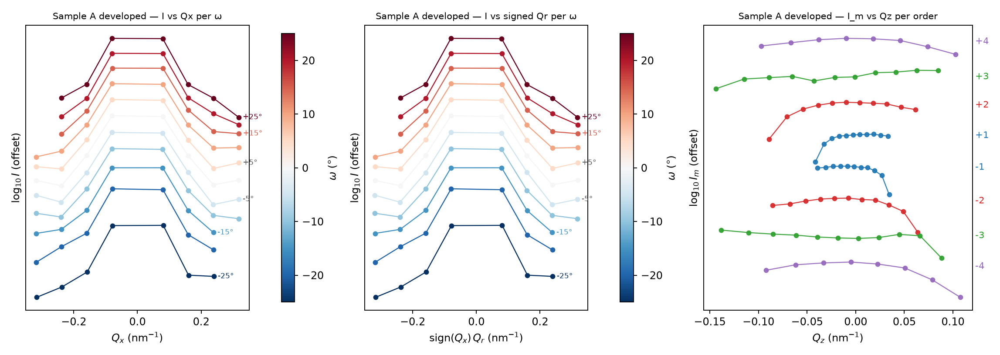
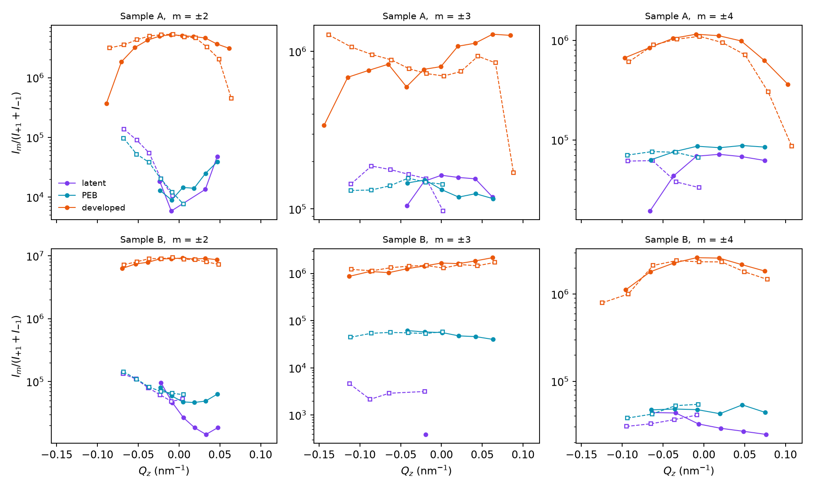
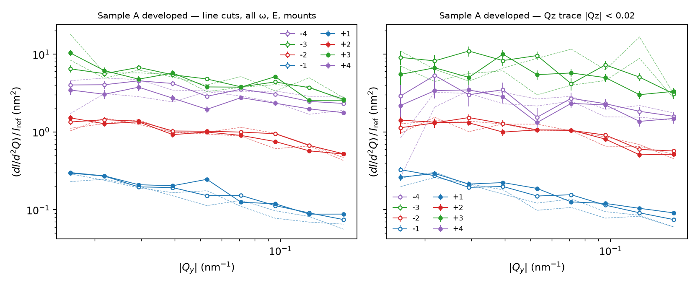
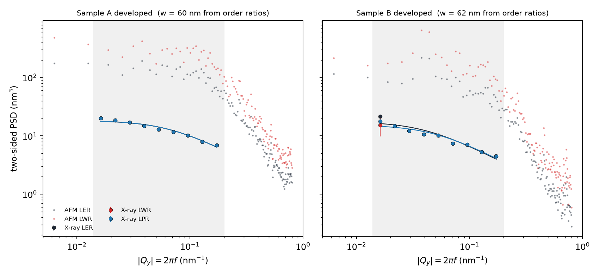
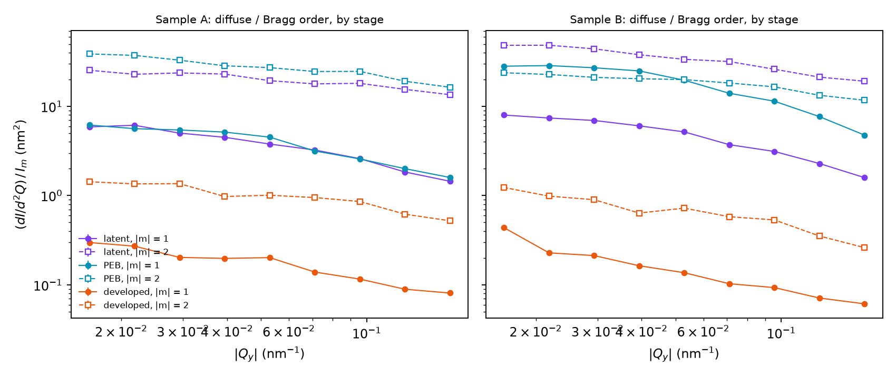
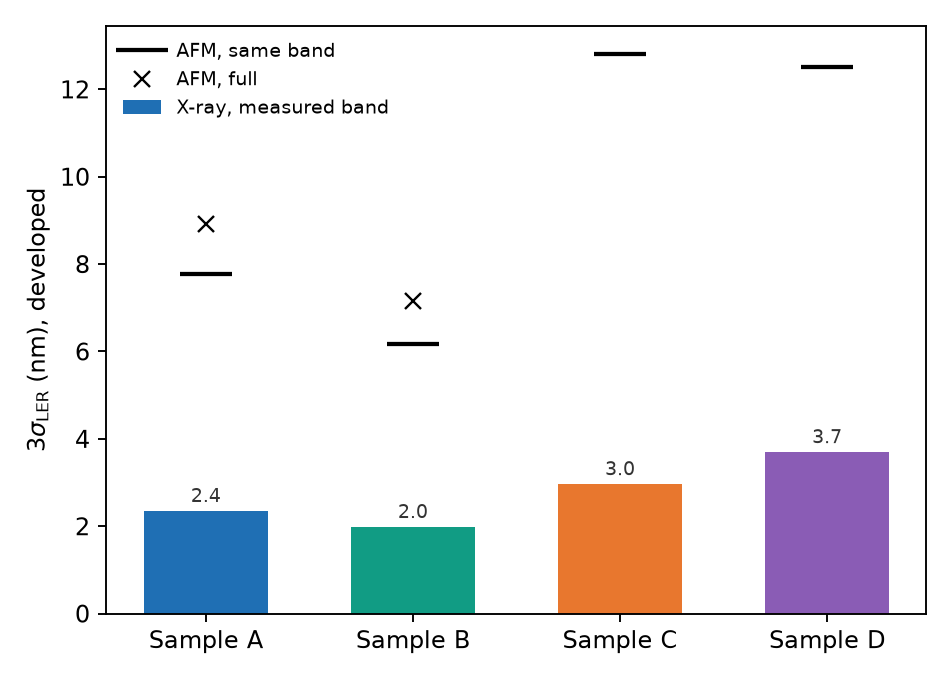

# Case study: resist line gratings

This case study runs measured CD-RSoXS tilt series of four resist line gratings (Samples A–D) through the full `cd-reduce` pipeline. Each sample was measured at three processing stages: latent image, post-exposure bake (PEB) and developed. Samples A and B are the best-performing systems. The data are anonymised.

**Measurement:** transmission tilt series, ω from −25° to +25°, at 280, 285.2 and 288.6 eV, on the 1024² CCD. Samples A and B were measured on three mounts (centre, left, right); C and D on one.

**Driver:** `examples/case_study_resist_gratings.py`. It reads a private JSON config that maps the aliases to the data, and writes only anonymised figures and tables.

```bash
uv run python examples/case_study_resist_gratings.py private_config.json out/
```

## Pipeline per frame

1. **Strip-fit background** (`bg_mode="strip_fit"`):
   - row/column detector offset
   - Poisson-deviance fit of a flat floor, pseudo-Voigt orders and BIC-selected bleed components
   - read-noise gate at 15 ADU (1 photon = 27 ADU)
2. **Per-ω geometry:** calibrated geometry with rod-verticality refinement (Lb scale, ω zero, period, scattering-origin motion `c0 + t sin ω`).
3. **Pixel → Q** with the exact Ewald sphere, or the small-angle approximation for comparison.
4. **Spot extraction and order indexing**, giving the discrete I vs Qx and I_m vs Qz plots.
5. **Diffuse ratio** R_m(|Qy|):
   - read from every frame, energy and mount
   - pooled as a ratio of sums, with 5σ leave-one-out clipping
   - decomposed into LER / LWR / LPR

## Reciprocal-space maps



The dashed line is the ω = 0 Qy = 0 locus in each mapping. The exact mapping bends the rods along the Ewald sphere; the small-angle mapping keeps them straight.





## Specular reduction





## Diffuse scattering and roughness



The inter-order flank level (dashed) follows the on-rod wing. The diffuse is therefore continuous in Qx: the edge roughness is uncorrelated from line to line, which is the regime the Born decomposition assumes.







## What to take away

Developed stage, band-limited over $0.014 < |Q_y| < 0.2$ nm⁻¹ ([table](summary_roughness.csv)):

| | X-ray 3σ LER (nm) | AFM 3σ LER, same band (nm) |
|---|---|---|
| Sample A | 2.4 | 7.8 |
| Sample B | 2.0 | 6.2 |
| Sample C | 3.0 | 12.8 |
| Sample D | 3.7 | 12.5 |

- **Ranking.** X-ray and AFM agree that Samples A and B are the smoothest (B < A < C, D). The X-ray contrast between the best and worst sample is smaller than in AFM.
- **Absolute level.** The X-ray PSDs sit about 3–5× below AFM over the same band, and are flatter. An independent earlier analysis of the same frames gives the same gap, so it comes from the measurement comparison, not the pipeline. Candidate causes:
  - AFM tip convolution and noise
  - the box-profile kernel (sidewall angle, top rounding)
  - roughness that is not fully conformal through the line height
- **Processing stages (model-free, figure above).** Relative to the Bragg orders, the diffuse drops about 20–50× from latent/PEB to developed while keeping its Qy shape. The latent image's scattering contrast is dominated by a diffuse chemical edge. The box-edge kernel does not apply to a chemical gradient, so no PSDs are quoted for latent and PEB.
- **LWR / LPR split: exploratory.** The split depends strongly on the assumed line width. With the AFM CD (duty about 0.78), A and B come out almost pure LPR (ρ → 1), while a width fitted from the order ratios gives a different split. LER is the robust result; the split is given in the CSV and the PSD figure only. A profile model fitted to the specular rods (sidewall angle, height) would pin the kernel down.
