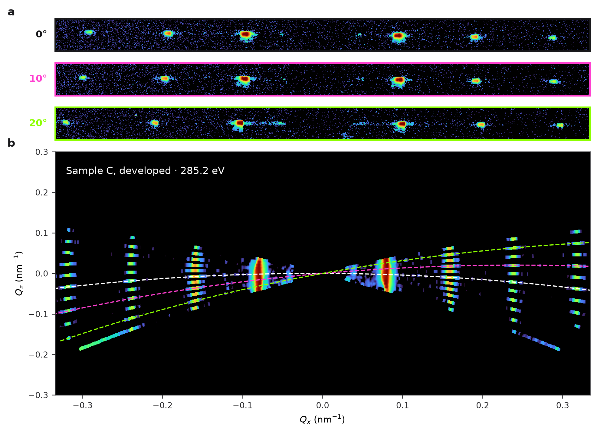
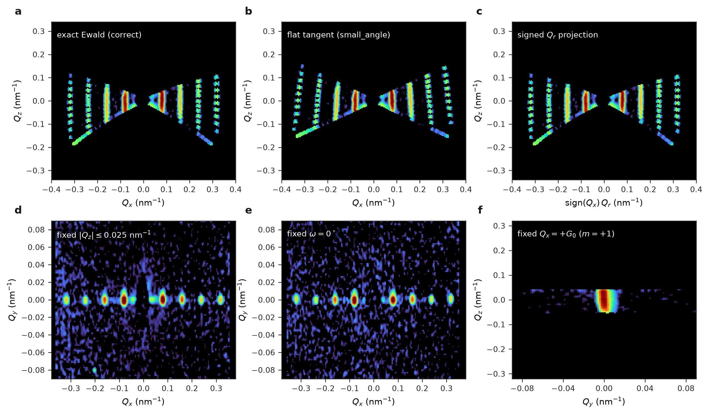
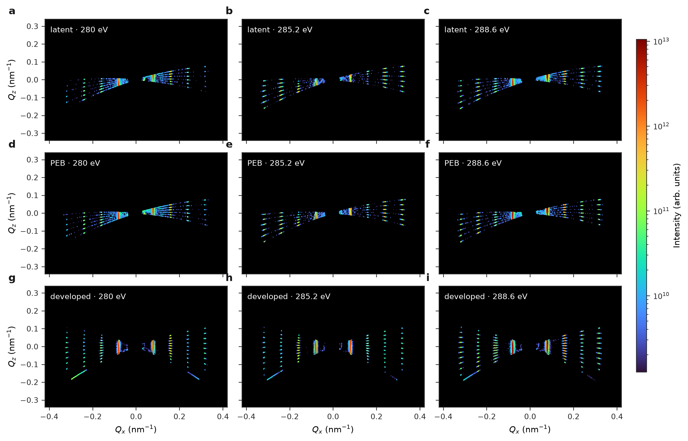

# 2D domains and Ewald geometry

[`CdRsoxsLoader.to_qmap_2d`](../../api/python/loader.md#cd_reduce.loader.CdRsoxsLoader.to_qmap_2d) and [`map_2d`](../../api/python/reduction.md#cd_reduce.reduction.mapping.map_2d) project a stack of CCD frames onto any 2D coordinate pair and render intensity on black panels using the spectral `turbo` colormap (`bad="black", under="black"`).

## From Thin CCD Detector Strips to the $(Q_x, Q_z)$ Butterfly

Each narrow CCD detector strip recorded at a single sample tilt $\omega$ (panel **a**: $0^\circ$ white, $10^\circ$ magenta, $20^\circ$ lime) maps onto a curved Ewald trajectory across $(Q_x, Q_z)$ (panel **b**, dashed arcs). Accumulating all tilts builds the characteristic butterfly wedge populated by vertical Bragg truncation rods at $Q_x = m G_0$.



## 2D Coordinate Projections, Ewald Modes, and Orthogonal Cuts

`to_qmap_2d` lets you switch coordinate pairs, Ewald approximations, and orthogonal slice conditions on the same dataset:

- **Panel a (`approximation="correct"`)**: exact 3D Ewald sphere transformation $\mathbf{Q}_{\mathrm{lab}} = k_0(\hat{\mathbf{s}} - \hat{\mathbf{z}})$ rotated into the sample frame, keeping all Bragg rods vertical while preserving true Ewald curvature.
- **Panel b (`approximation="small_angle"`)**: linearized flat-detector tangent approximation ($Q_x \approx Q_{\mathrm{lab},v}\cos\omega$, $Q_z \approx -Q_{\mathrm{lab},v}\sin\omega$), which visibly bows higher orders outward at large $|\omega|$.
- **Panel c (`x_domain="signed_Qr"`)**: radial in-plane projection $\operatorname{sgn}(Q_x)\sqrt{Q_x^2 + Q_y^2}$ vs. $Q_z$.
- **Panel d vs. e (`(Qx, Qy)` at fixed $Q_z$ vs. fixed $\omega$)**: `qz_cut=(-0.025, 0.025)` isolates the horizontal $Q_z \approx 0$ plane across tilts (d), whereas `omega_cut=(-1.2, 1.2)` isolates the normal-incidence detector plane without missing Ewald wedges (e).
- **Panel f (`(Qy, Qz)` at fixed $Q_x = +G_0$)**: `qx_cut=(G0 - dQ, G0 + dQ)` isolates the 2D off-specular diffuse sheet around $m = +1$. Replacing `qx_cut` with `qr_cut` slices along a constant-$Q_r$ cylinder instead.



```python
import numpy as np
import cd_reduce as cdr

G0 = 2.0 * np.pi / loader.pitch_nm

# Exact Ewald vs. small-angle and signed radial projections
qm_correct = loader.to_qmap_2d("Qx", "Qz", bins=(220, 170), approximation="correct")
qm_small = loader.to_qmap_2d("Qx", "Qz", bins=(220, 170), approximation="small_angle")
qm_sqr = loader.to_qmap_2d("signed_Qr", "Qz", bins=(220, 170), approximation="correct")

# (Qx, Qy) at fixed Qz vs. fixed omega
qm_qxqy_qz = loader.to_qmap_2d("Qx", "Qy", bins=(220, 120), qz_cut=(-0.025, 0.025))
qm_qxqy_om = loader.to_qmap_2d("Qx", "Qy", bins=(220, 120), omega_cut=(-1.2, 1.2))

# (Qy, Qz) sheet at fixed Qx = +G0 (or fixed Qr = G0 via qr_cut=...)
qm_qyqz_m1 = loader.to_qmap_2d(
    "Qy", "Qz", bins=(110, 150), qx_cut=(G0 - 0.012, G0 + 0.012)
)
```

## Multi-Stage and Multi-Energy $(Q_x, Q_z)$ Comparison

Across lithographic processing stages (`latent`, `PEB`, `developed`) and resonant photon energies (`280 eV`, `285.2 eV`, `288.6 eV`), chemical contrast in `latent` and `PEB` films concentrates intensity near $Q_z \approx 0$ (panels **a–f**), while topographic relief after development extends truncation rods over a broad $Q_z$ envelope (panels **g–i**).



## Solid-Angle and Polarization Corrections

When `apply_geometric_correction=True` (default), pixel intensities are normalized by the planar detector solid-angle Jacobian $\cos^3(2\theta)$ and Thomson polarization factor (`polarization="s"`, `"p"`, or `"unpolarized"`).
