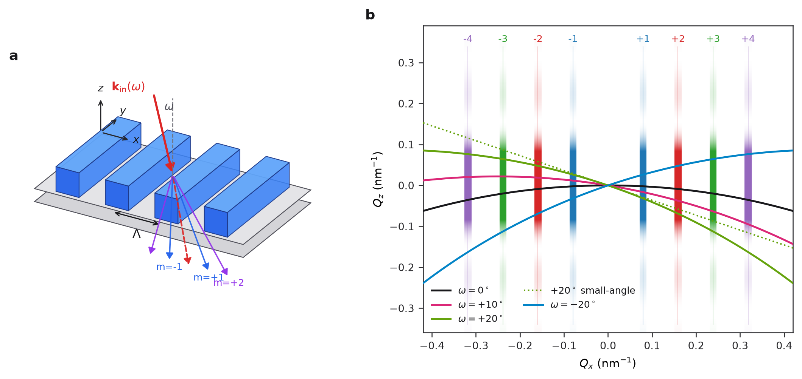

# Reciprocal-space mapping

Guide to converting a tilt series of CCD images into 2D reciprocal-space maps ([`QMap2D`](../../api/python/reduction.md#cd_reduce.reduction.mapping.QMap2D)) across any pair of scattering coordinates, selecting fixed-$Q$ or fixed-$\omega$ cuts, comparing exact Ewald vs. small-angle geometry, and extracting specular and off-specular 1D traces ([`Trace1D`](../../api/python/reduction.md#cd_reduce.reduction.mapping.Trace1D)).

In transmission geometry (panel **a**), rotating a periodic line grating of pitch $\Lambda$ about the line axis $\hat{\mathbf{y}}$ by tilt angle $\omega$ sweeps the curved Ewald sphere across the reciprocal-space Bragg truncation rods at $Q_x = m G_0 = 2\pi m / \Lambda$ (panel **b**). Stacking all tilts reconstructs the cross-sectional form factor along $Q_z$ and off-specular roughness streaks along $Q_y$.

## Contents

| Page | What it covers |
| --- | --- |
| [2D domains and Ewald geometry](domains_2d.md) | Detector-strip to $(Q_x, Q_z)$ butterfly mapping, multi-stage $\times$ multi-energy maps, exact Ewald (`"correct"`) vs. flat-detector (`"small_angle"`) projections, radial (`Qr`, `signed_Qr`) maps, and fixed-$Q$/fixed-$\omega$ slices |
| [Slicing and 1D traces](slicing_and_1d.md) | Specular $I$ vs. $Q_x$ per $\omega$ (`extract_qx_by_omega`), specular $I$ vs. $Q_z$ per order (`extract_order_rods_qz`), and arbitrary 1D cuts (`to_trace_1d`, `QMap2D.slice_1d`) |
| [LER / LWR / LPR PSDs](roughness_psd.md) | Roughness PSDs from the off-specular diffuse: `reduce_frame`, `fit_psds`, isolation rows, `PsdRecord`, and reduced $Q_x$–$Q_z$ / $Q_y$–$Q_z$ maps (`map_reduced`) |

## Supported Coordinate Domains

Every pixel across every frame in a tilt series can be projected onto any combination of 10 domains:

| Domain Key | Symbol & Units | Definition |
| --- | --- | --- |
| `"Qx"` | $Q_x\ (\mathrm{nm}^{-1})$ | Grating diffraction axis ($\perp$ lines, in-plane) |
| `"Qy"` | $Q_y\ (\mathrm{nm}^{-1})$ | Line-direction axis ($\parallel$ lines, in-plane) |
| `"Qz"` | $Q_z\ (\mathrm{nm}^{-1})$ | Out-of-plane axis ($\parallel$ substrate normal) |
| `"Qr"` | $Q_r\ (\mathrm{nm}^{-1})$ | In-plane radial wavevector $\sqrt{Q_x^2 + Q_y^2}$ |
| `"signed_Qr"` | $\operatorname{sgn}(Q_x)\,Q_r\ (\mathrm{nm}^{-1})$ | Signed in-plane radial wavevector |
| `"Q"` | $|\mathbf{Q}|\ (\mathrm{nm}^{-1})$ | Total 3D wavevector magnitude $\sqrt{Q_x^2 + Q_y^2 + Q_z^2}$ |
| `"omega"` | $\omega\ (\mathrm{deg})$ | Calibrated sample tilt angle |
| `"two_theta"` | $2\theta\ (\mathrm{deg})$ | Total scattering angle from direct beam |
| `"px_x"`, `"px_y"` | $x, y\ (\mathrm{px})$ | Detector pixel coordinates |
