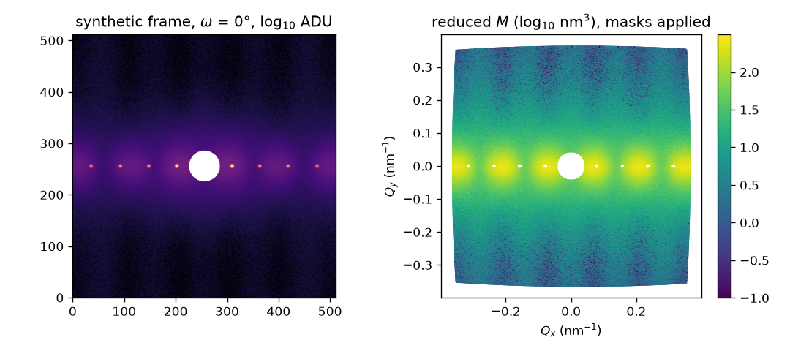
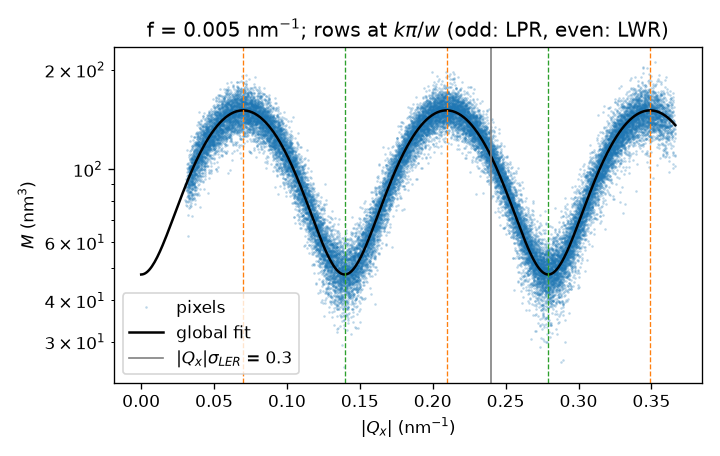
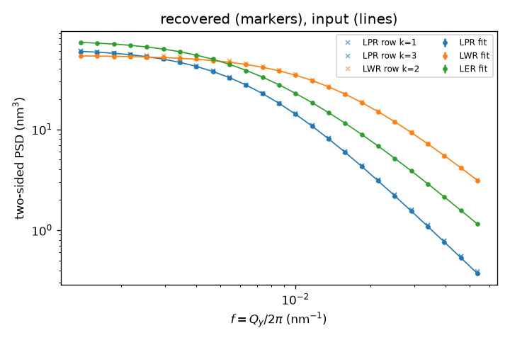
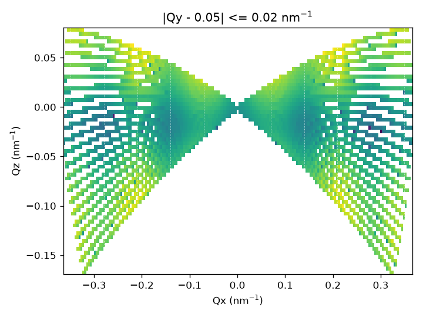

# LER, LWR and LPR PSDs from diffuse scattering

`cd_reduce.reduction.roughness` turns the off-specular diffuse of a rotation series into two-sided line-placement (LPR), line-width (LWR) and line-edge (LER) PSDs. PSDs are in $\mathrm{nm^3}$, as functions of $f = Q_y/2\pi$ in $\mathrm{nm^{-1}}$, with $\sigma^2 = \int S\,\mathrm df$ over both signs of $f$. The model and its limits are in [Roughness PSDs from diffuse scattering](../../theory/roughness_psd.md).

The workflow:

1. calibrated frames
2. absolute scale from the Bragg orders (`order_scale`)
3. per-pixel reduced intensity $M$ (`reduce_frame`)
4. global two-mode fit per $f$ bin (`fit_psds`)
5. isolation-row check (`purity_bands`, `isolation_row_psds`)
6. stored record (`PsdRecord.save`)
7. reduced maps (`map_reduced`, `plot_reduced_map`)

The figures below come from `examples/roughness_psd_howto.py`. It renders synthetic frames from known PSDs and runs steps 2 to 6 with a known scale.

## What you need

- **Calibrated frames and geometry.** Set up a `CdRsoxsLoader` as in [Data reduction](../reduction/index.md). Every pixel is mapped to the sample frame by `compute_pixel_q`.
- **A cross section per energy.** This is a `LatentFilm` or `DevelopedLine` from a prior fit of the specular and order intensities. It supplies $L$, $w$, $s$, $\Delta n_A$ and the edge contrast $|\Gamma(Q_z)|^2$. The PSDs scale as $1/|\Delta n_A\Gamma|^2$, so this is the largest systematic.
- **Detector gain** (`adu_per_photon`) and, if relevant, the upstream window transmission (`window_T`) and read noise (`read_noise_photons`).

```python
import numpy as np
import cd_reduce as cdr

xs_by_energy = {
    285.0: cdr.LatentFilm(
        L=80.0, w=45.0, s=2.5, h=40.0, dh=4.0, lam=25.0,
        r=1.15 + 0.05j, dn_A=-2e-3 + 1.5e-3j, energy_ev=285.0,
    ),
}
loader = cdr.CdRsoxsLoader("fits_dir", geometry="geometry.json", bg_mode="photon_events")
```

## 1. Absolute scale from the Bragg orders

The integrated order intensities fix the incident photon rate per energy, and give an independent full $\sigma_{\mathrm{LER}}$ through the Debye–Waller factor:

```python
orders = loader.build_order_table()
fit = cdr.order_scale(orders, xs_by_energy, adu_per_photon=27.0)
fit.scale_by_energy, fit.scale_err, fit.sigma_ler
sigma_dw, sigma_dw_err = cdr.debye_waller_sigma(orders, xs_by_energy, adu_per_photon=27.0)
```

If the incident rate is known, pass it as a float instead.

## 2. Reduce every frame to M

`reduce_frame` maps every pixel to $(Q_x, Q_y, Q_z)$ and divides out everything except the PSDs: the Born prefactor, solid angle, film absorption, window, $|\Gamma(Q_z)|^2$ and edge blur. What is left is

$$
M = 4\sin^2\!\tfrac{Q_x w}{2}\,S_{\mathrm{LPR}}(f) + \cos^2\!\tfrac{Q_x w}{2}\,S_{\mathrm{LWR}}(f) .
$$

It also drops pixels in the Bragg discs (`R_B`), behind the beamstop, where the contrast is below `keep` times its maximum, and near the zeros of $\Gamma$:

```python
frames_e = [fr for fr in loader.frames if np.isclose(fr.energy_ev, 285.0)]
pixels = cdr.ReducedPixels.concat([
    cdr.reduce_frame(
        fr, loader.geometry, xs_by_energy[285.0],
        scale=fit.scale_by_energy[285.0], adu_per_photon=27.0,
        R_B=0.008, keep=0.1, frame_id=i,
    )
    for i, fr in enumerate(frames_e)
])
```

`loader.reduce_roughness(xs_by_energy)` does this for every frame and energy, with `scale="bragg_orders"` by default.



If the cross section is right, $M$ does not depend on $\omega$ or $Q_z$. Compare fits of single $\omega$ groups (`pixels.select(...)`) before trusting the result.

## 3. Fit both PSDs per f bin

`fit_psds` solves a weighted two-mode least-squares problem in each $|f|$ bin, over every usable pixel. It takes model-based Poisson variances and iterates (IRLS). Per-pixel weights from the observed counts would bias the PSDs low at low counts.

Set `qx_max` to keep the fit inside the first-order range, $|Q_x|\sigma_{\mathrm{LER}} \lesssim 0.3$. The Debye–Waller $\sigma$ from step 1 is a good estimate of $\sigma_{\mathrm{LER}}$.

```python
qx_max = 0.3 / sigma_dw
table = cdr.fit_psds(pixels, w=45.0, qx_max=qx_max)   # PsdTable
table.S_lpr, table.S_lwr, table.S_ler, table.var_lpr, table.cond, table.chi2_red
```



Check `cond`. Pixels that cover both kinds of null separate the modes; pixels only near the orders do not. With `cross_term=True` the fit also carries $\operatorname{Im}S_{PW}$. `quick_ler(pixels, w, f_edges)` gives $S_{\mathrm{LER}}$ with no fit at all, as the mean of $M$ over whole periods of $Q_x w$.

## 4. Check with the isolation rows

At $Q_x = k\pi/w$ one weight vanishes. Odd $k$ rows hold $4S_{\mathrm{LPR}}$ alone and even $k$ rows $S_{\mathrm{LWR}}$ alone. `purity_bands` finds the $Q_x$ bands where the target mode carries at least a fraction `p` of $M$ over the whole window, given a prior. `isolation_row_psds` estimates each PSD from those bands alone:

```python
fc = table.f_center[np.isfinite(table.S_lpr)]
prior_lpr = lambda f: np.interp(f, table.f_center, table.S_lpr)  # or AFM, or a model
prior_lwr = lambda f: np.interp(f, table.f_center, table.S_lwr)
bands = cdr.purity_bands(45.0, prior_lpr, prior_lwr, (fc[0], fc[-1]), 0.9, qx_max)
rows = cdr.isolation_row_psds(pixels, 45.0, bands, table.f_edges, qx_max=qx_max)
rows["lpr"][1]["S"], rows["lwr"][2]["S"]   # per k, on the same f bins
```

The rows should agree with the global fit within errors. An offset that grows with $k$ points to a wrong $w$, $s$ or $|\Gamma|$.



## 5. σ in the window and the stored record

`CdRsoxsLoader.extract_psds` runs steps 1 to 3 and returns a `PsdRecord`. The record holds the table, the cross section used, the scale and its source, the data used and $\sigma_{\mathrm{win}}$ for each mode:

```python
record = loader.extract_psds(xs_by_energy, adu_per_photon=27.0, qx_max=qx_max)
record.sigma_win["ler"]          # (sigma, error) in nm, over record.window only
record.save("psds.csv")          # CSV table with a JSON metadata header
record = cdr.PsdRecord.load("psds.csv")
record_refit = record.rescale(new_cross_section)   # after a cross-section refit
```

For a single table, `sigma_window(table.f_center, S, var)` gives $\sigma$ over the measured window. That is the model-free number to report. To extrapolate beyond the window, fit a model with `fit_psd_model(f, S, sigma_S, model="mack")` (models in `PSD_MODELS`), and report the extrapolated fraction separately.

## 6. Reduced maps

`map_reduced` bins the reduced intensity $\mathcal D = M\,|\Gamma|^2 e^{-Q_x^2 s^2}$ of every pixel of every frame into a $Q_x$–$Q_z$ or $Q_y$–$Q_z$ slab. It weights by exposure, so that zero-count pixels are kept and low-count bins are not biased. `plot_reduced_map` marks the isolation rows $Q_x = \pm k\pi/w$. Along such a column, $\mathcal D(Q_z)$ is $|\Gamma(Q_z)|^2$ times one PSD value: a direct test of the cross section.

```python
qmap = cdr.map_reduced(pixels, "qx-qz", slab_center=0.05, slab_halfwidth=0.02,
                       bin_q=(0.004, 0.004))
ax = cdr.plot_reduced_map(qmap, w=45.0)
```



Choose `bin_q` from the detector pitch in $Q$ (`detector_q_pitch(geometry, energy_ev)`). A slab that excludes $Q_y = 0$ shows no Bragg rods.

## Validation

The reduction is tested on frames simulated with the analytic model and on 3D Born and multislice ensembles of explicit rough edges. See `tests/validation/README.md` for what each test proves and the numbers it measured.
