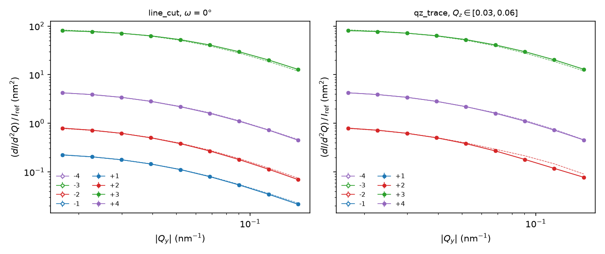
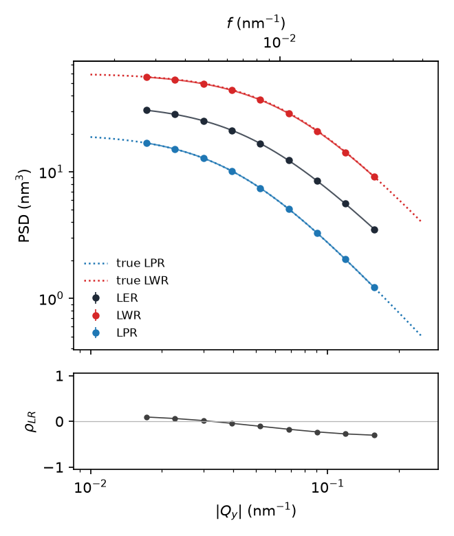
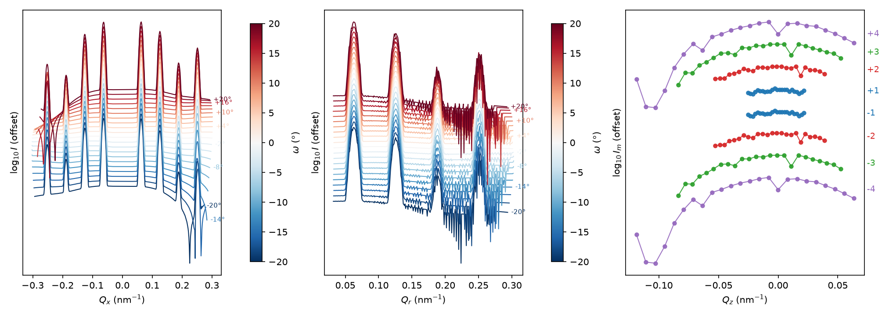

# LER, LWR and LPR PSDs from diffuse scattering

`cd_reduce.reduction.roughness` turns the off-specular diffuse wings around each Bragg order into the line-placement (LPR), line-width (LWR) and line-edge (LER) power spectral densities.

## Physics

A line of width $w$ has the form factor $F(q_x) = 2\sin(q_x w/2)/q_x$. Edge displacements $\delta_L(y)$, $\delta_R(y)$ change it by

$$\delta F = -2i\sin(q_x w/2)\,P + \cos(q_x w/2)\,W,\qquad P = \tfrac{1}{2}(\delta_L+\delta_R),\; W = \delta_R-\delta_L .$$

For roughness uncorrelated from line to line (first-order Born, conformal in $z$), the diffuse intensity per unit $Q_xQ_y$ area divided by the integrated order is

$$R_m(Q_y) = \frac{dI/d^2Q}{I_{\rm ref}} = \frac{p}{(2\pi)^2 F_{\rm ref}^2}\Big[4\sin^2\!\tfrac{mGw}{2}\,S_{\rm LPR}(Q_y) + \cos^2\!\tfrac{mGw}{2}\,S_{\rm LWR}(Q_y)\Big].$$

Contrast, height and the $Q_z$ form factor cancel. Each order weights $S_{\rm LPR}$ and $S_{\rm LWR}$ differently, so `decompose_edge_psd` solves a weighted non-negative least-squares fit across orders for every $Q_y$ bin. With equal left and right edge statistics, $S_{\rm LER} = S_{\rm LPR} + S_{\rm LWR}/4$ and the edge correlation is $\rho = (S_{\rm LPR} - S_{\rm LWR}/4)/S_{\rm LER}$. PSDs are two-sided, with $\sigma^2 = \frac{1}{\pi}\int_0^\infty S\,dQ_y$.

Limits:

- **50 % duty cycle.** Odd orders are blind to LWR and even orders are extinct, so the split is ill-conditioned. Check the `condition` column. If fewer than two usable orders remain in a bin, the code falls back to a single-edge LER with $\rho = 0$ (`decomposed=False`).
- **Line-to-line correlation.** The `flank_ratio` column measures the level between orders. Excess intensity localised on the rod above it means the roughness is correlated from line to line; `use="wing_minus_flank"` isolates that part.

## Choosing where I(Qy) is read

| `mode` | What contributes | Use |
|---|---|---|
| `"line_cut"` | Detector line cut through each order in the frame at `omega`. $Q_z$ follows that frame's Ewald trace. | Standard read-off, e.g. at $\omega = 0$ |
| `"qz_trace"` | Pixels with $Q_z$ in `qz_range` from every frame, each normalised by the order rod $I_m(Q_z)$ interpolated at the pixel's own $Q_z$ | PSD at a chosen height frequency; checks whether roughness is conformal through the height |

Two corrections are on by default:

- **Core background.** The integrated core has the local diffuse level, measured in a ring around it, subtracted. This matters for weak orders near extinction.
- **Ewald correction** (`ewald_correction=True`). Wing pixels at large $|Q_y|$ sit at $\Delta Q_z \approx -Q_y^2/2k$ below their core. When `source` is a tilt series, the measured rods correct for this. A single frame cannot be corrected, and `metadata["ewald_correction"]` is then `False`.



## Usage

```python
import cd_reduce as cdr

loader = cdr.CdRsoxsLoader("fits_dir", geometry="geometry.json", bg_mode="photon_events")
ratio = loader.extract_diffuse_ratio(mode="line_cut", omega=0.0,
                                     qy_edges=np.geomspace(0.015, 0.2, 13))
res = cdr.decompose_edge_psd(ratio, line_width_nm=32.0)
fits = {k: res.fit(k, model="mack") for k in ("LER", "LWR", "LPR")}
sigma_ler, dsigma = res.sigma("LER")      # band-limited RMS over the measured Qy
cdr.plot_edge_psds(res, fits=fits)

# along a constant-Qz trace instead
ratio_qz = loader.extract_diffuse_ratio(mode="qz_trace", qz_range=(0.03, 0.06))
```

PSD models in `PSD_MODELS`: `mack` (Palasantzas/Mack), `mack_floor`, `power_law`, and `spectral_peak` (Mack plus a Gaussian peak). The line width can be estimated from $Q_z \approx 0$ order ratios with `estimate_line_width`.



## Validation

`tests/test_roughness.py` checks the code in two ways:

1. **Kernel and decomposition.** An exact Fourier transform of rough lines with independent P and W processes, compared against the decomposition.
2. **End to end.** Synthetic detector frames from `cd_reduce.simulation.diffuse.synthetic_rough_grating_frame`, which include Ewald curvature, pixel areas and Poisson noise, run through both modes.

Recovery is within about 2 % per bin at high flux.

## Other figures

`examples/roughness_and_figures.py` produces every standard plot:

- detector strips per ω
- exact vs small-angle butterfly maps (`plot_qmap_grid`)
- maps in every plane
- `I` vs `Qx` and `I` vs `Qr` per ω, with a colour bar and ω labels (`plot_traces_by_omega`, from `extract_qx_by_omega(domain="Qx" | "Qr" | "signed_Qr")`)
- labelled `I_m` vs `Qz` rods (`plot_rods_by_order`)


