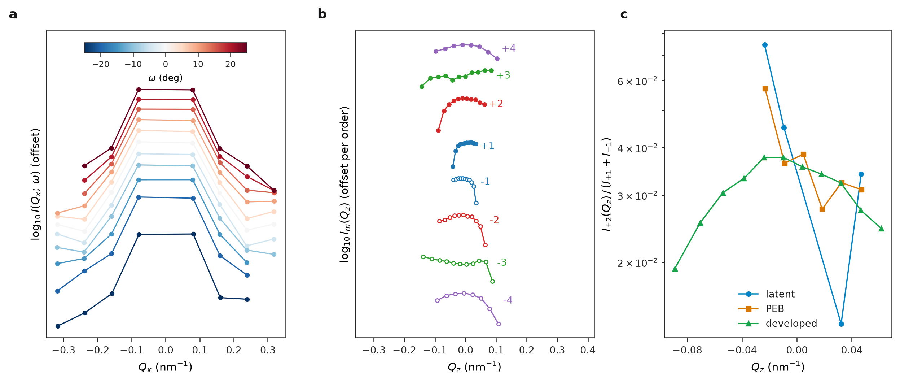
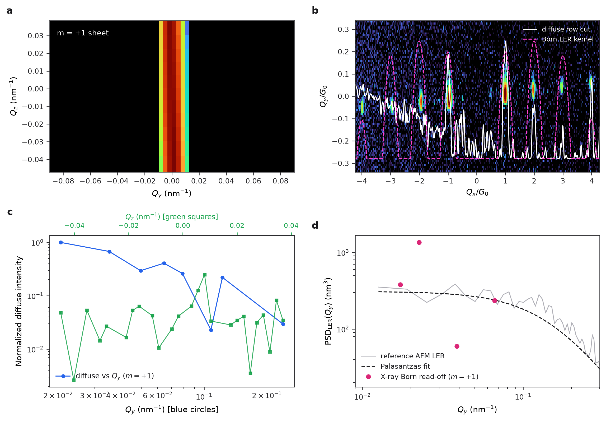

# Slicing, 1D traces, and LER PSD

From a calibrated tilt series or projected [`QMap2D`](../../api/python/reduction.md#cd_reduce.reduction.mapping.QMap2D), `cd-reduce` separates **specular Bragg diffraction** ($Q_y \approx 0$) from **off-specular diffuse roughness scattering** ($Q_y \neq 0$) across every diffraction order $m$ and tilt angle $\omega$.

## Specular 1D Extraction: $I(Q_x;\,\omega)$ and $I_m(Q_z)$

The two primary specular 1D reductions extract order intensities either per tilt angle $\omega$ or per diffraction order $m$:

1. **$I$ vs. $Q_x$ for each tilt $\omega$** ([`extract_qx_by_omega`](../../api/python/reduction.md#cd_reduce.reduction.mapping.extract_qx_by_omega) / [`CdRsoxsLoader.extract_qx_by_omega`](../../api/python/loader.md#cd_reduce.loader.CdRsoxsLoader.extract_qx_by_omega)): returns `{omega_deg: Trace1D}` across all indexed Bragg orders, revealing Friedel tilts and order-envelope evolution with $\omega$ (panel **a**).
2. **$I$ vs. $Q_z$ for each order $m$** ([`extract_order_rods_qz`](../../api/python/reduction.md#cd_reduce.reduction.mapping.extract_order_rods_qz) / [`CdRsoxsLoader.extract_order_rods_qz`](../../api/python/loader.md#cd_reduce.loader.CdRsoxsLoader.extract_order_rods_qz)): returns `{order: Trace1D}` along each Bragg truncation rod $+4 \dots -4$, encoding the 2D cross-sectional line profile (panel **b**). Setting `normalize_first_order=True` computes $I_m(Q_z) / \bigl(I_{+1}(Q_z) + I_{-1}(Q_z)\bigr)$, canceling incident flux and contrast prefactors across `latent`, `PEB`, and `developed` stages (panel **c**).



```python
import cd_reduce as cdr

# 1. Main view A: I vs Qx for each sample tilt omega
ridges_by_omega = loader.extract_qx_by_omega()  # dict[float, Trace1D]

# 2. Main view B: I vs Qz for each diffraction order m
rods_by_order = loader.extract_order_rods_qz(
    orders=(-4, -3, -2, -1, 1, 2, 3, 4),
    normalize_first_order=False,
)

# First-order normalized ratio I_{+2}(Qz) / (I_{+1} + I_{-1})
rods_norm = loader.extract_order_rods_qz(orders=(2,), normalize_first_order=True)
```

Arbitrary single-domain cuts at any fixed $(Q_x, Q_y, Q_z, Q_r, \omega)$ window are also available via [`CdRsoxsLoader.to_trace_1d`](../../api/python/loader.md#cd_reduce.loader.CdRsoxsLoader.to_trace_1d) and [`QMap2D.slice_1d`](../../api/python/reduction.md#cd_reduce.reduction.mapping.QMap2D.slice_1d).

## Off-Specular Diffuse Extraction and Born LER $\mathrm{PSD}(Q_y)$

Line-edge and line-width roughness scatter intensity out of the $Q_y = 0$ specular plane into off-specular diffuse sheets around each Bragg rod $Q_x = m G_0$:

- **2D off-specular sheet** ([`extract_offspec_rod_map`](../../api/python/reduction.md#cd_reduce.reduction.mapping.extract_offspec_rod_map)): maps normalized differential cross-section $(dI / d^2Q) / I_m$ onto $(Q_y, Q_z)$ around order $m$ (panel **a**).
- **Directional 1D diffuse cuts** ([`extract_diffuse_cut`](../../api/python/reduction.md#cd_reduce.reduction.mapping.extract_diffuse_cut)): extracts off-specular diffuse intensity along any chosen direction:
  - `direction="Qx"` — in-plane off-specular profile across orders at $|Q_y| \in [Q_{y,\min}, Q_{y,\max}]$, matching the Born sidewall kernel (panel **b**),
  - `direction="Qy"` — transverse roughness streak $I_{\mathrm{diff}}(Q_y)$ through order $m$ (panel **c**, blue circles),
  - `direction="Qz"` — vertical correlation wing $I_{\mathrm{diff}}(Q_z)$ integrated over off-specular $|Q_y|$ bands around order $m$ (panel **c**, green squares).
- **Parameter-free Born LER PSD read-off** ([`readoff_edge_psd_born`](../../api/python/reduction.md#cd_reduce.reduction.mapping.readoff_edge_psd_born)): converts the ratio of off-specular wing photons to integrated Bragg core photons directly into $\mathrm{PSD}_{\mathrm{LER}}(Q_y)\ [\mathrm{nm}^3]$, agreeing quantitatively with independent AFM line-edge scans and Palasantzas fits (panel **d**).



```python
import numpy as np

# 2D off-specular sheet (Qy, Qz) around m = +1
offspec_m1 = loader.extract_offspec_rod_map(order=1, qy_range=(-0.09, 0.09), n_qy=56)

# Directional 1D diffuse cuts along Qy, Qz, or Qx
cut_qy = loader.extract_diffuse_cut(direction="Qy", order=1, bins=50)
cut_qz = loader.extract_diffuse_cut(
    direction="Qz", order=1, qy_band_inv_nm=(0.018, 0.065), bins=36
)
cut_qx = loader.extract_diffuse_cut(
    direction="Qx", qy_band_inv_nm=(0.018, 0.065), bins=180
)

# Parameter-free Born LER PSD(Qy) read-off [nm^3]
psd_df = loader.readoff_edge_psd(
    img_clean,
    pq.Qx,
    pq.Qy,
    order=1,
    line_width_nm=41.0,
    qy_edges=np.geomspace(0.014, 0.14, 18),
)
```
