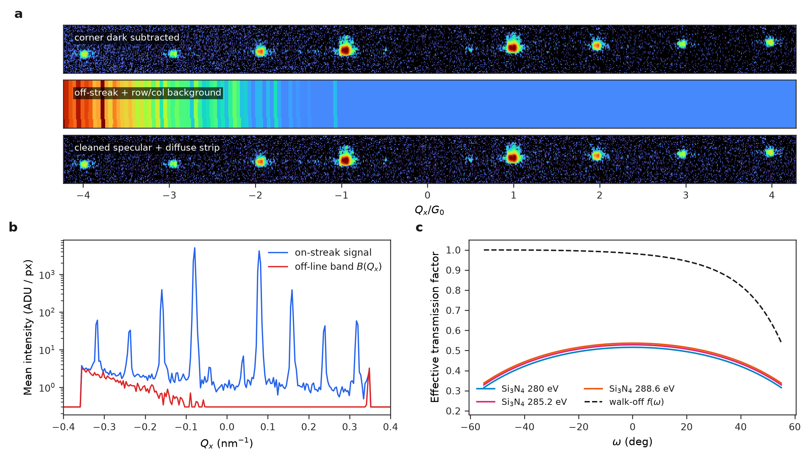

# Backgrounds and corrections

Transmission CD-RSoXS CCD frames contain electronic dark offset, readout row/column ramps, scattered fluorescence halos near the beamstop, $\mathrm{Si_3N_4}$ membrane attenuation at high tilt $|\omega|$, and beam footprint walk-off. `cd-reduce` provides composable per-frame and per-strip routines for each stage.



## Background Subtraction Modes

`CdRsoxsLoader(..., bg_mode=...)` supports five background subtraction algorithms:

| `bg_mode` | Function | Physical Model |
| --- | --- | --- |
| `"corner"` | [`subtract_corner_offset`](../../api/python/reduction.md#cd_reduce.reduction.corrections.subtract_corner_offset) | Subtracts the median of the four $100 \times 100\text{ px}$ detector corners and estimates per-pixel readout noise $\sigma_{\mathrm{read}}$ via MAD |
| `"row_col"` | [`subtract_row_col_offset`](../../api/python/reduction.md#cd_reduce.reduction.corrections.subtract_row_col_offset) | Subtracts per-row medians followed by a cubic column ramp fitted outside the diffraction streak ($|Q_y| > 0.04\ \mathrm{nm}^{-1}$) and beamstop shadow |
| `"offline_band"` | [`subtract_offline_band_background`](../../api/python/reduction.md#cd_reduce.reduction.corrections.subtract_offline_band_background) | Subtracts a $Q_x$-resolved background profile $B(Q_x)$ measured from symmetric off-streak $Q_y$ bands (panel **a–b**) |
| `"strip_fit"` | [`process_frame_strip`](../../api/python/reduction.md#cd_reduce.reduction.corrections.process_frame_strip) | Rotates the narrow diffraction strip, fits linear column backgrounds across side bands, flags cosmic spikes, and masks saturated cores |
| `"photon_events"` | [`threshold_photon_events`](../../api/python/reduction.md#cd_reduce.reduction.corrections.threshold_photon_events) | Applies single-photon event thresholding above $n\sigma_{\mathrm{read}}$ for ultra-low-flux frames |

```python
import numpy as np
import cd_reduce as cdr

frames = cdr.load_frames("/path/to/sample_c_developed", energy_ev=285.2)
valid_mask = ~cdr.build_beamstop_mask(frames, geom)

fr = frames[5]
xx, yy = cdr.frame_pixel_grid(fr.image.shape, bin_px=1)
pq = cdr.compute_pixel_q(geom, xx, yy, fr.energy_ev, fr.omega_deg)

# 1. Corner dark offset
img_corner, offset_adu, sigma_read = cdr.subtract_corner_offset(fr.image)

# 2. Row median + cubic column ramp
img_rc = cdr.subtract_row_col_offset(img_corner, geom, pq.Qy, valid_mask)

# 3. Off-line Qy band subtraction B(Qx)
qx_edges = np.linspace(-0.45, 0.45, 241)
img_band, bg_profile = cdr.subtract_offline_band_background(
    img_rc, pq.Qx, pq.Qy, geom.g_inv_nm, qx_edges
)
```

## $\mathrm{Si_3N_4}$ Window Transmission and Beam Walk-Off

At high sample tilts $|\omega|$, the optical path through the $\mathrm{Si_3N_4}$ membrane increases as $t_{\mathrm{Si_3N_4}} / \cos\omega$ and the tilted grating pad can walk partially out of the incident Gaussian beam footprint (panel **c**):

$$
T(\omega, E) = \exp\!\left(-\frac{\mu_{\mathrm{Si_3N_4}}(E)\,t_{\mathrm{Si_3N_4}}}{\cos\omega}\right), \qquad f(\omega; a, b) = \Phi(a - b\tan\omega)
$$

Both corrections are evaluated automatically in `CdRsoxsLoader` via [`membrane_transmission`](../../api/python/reduction.md#cd_reduce.reduction.corrections.membrane_transmission) and [`walkoff_factor`](../../api/python/reduction.md#cd_reduce.reduction.corrections.walkoff_factor).

## Template Transfer for Weakly Scattering Processing Stages

For weakly scattering `latent` and post-exposure bake (`PEB`) gratings where high-order spots sit near the noise floor, [`extract_template_amplitudes`](../../api/python/reduction.md#cd_reduce.reduction.spots.extract_template_amplitudes) transfers the calibrated spot shapes and pixel coordinates from a high-contrast `developed` reference series onto the target frames using linear least-squares PSF fitting over a local quadratic background.
