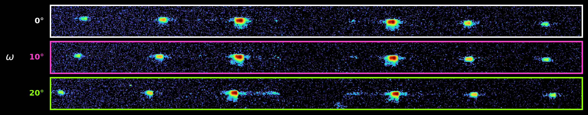
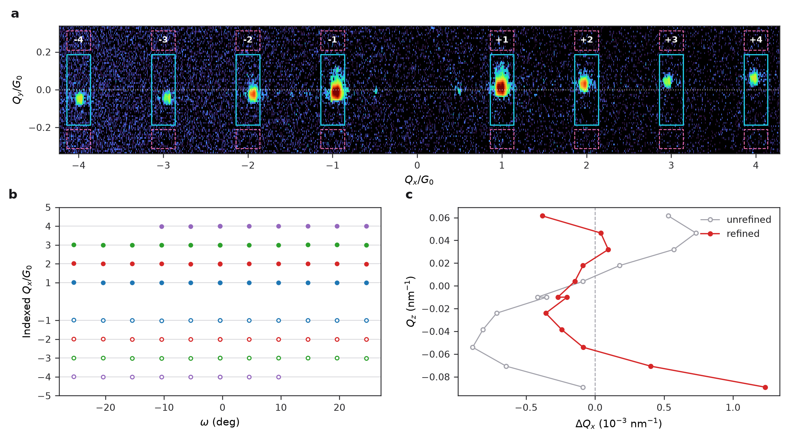

# Spot extraction and calibration

In transmission CD-RSoXS and CD-SAXS on a 1D line grating, all specular diffraction orders lie along a narrow streak ($Q_y \approx 0$) across the 2D CCD detector. Rotating the sample through tilt angle $\omega$ shifts the diffraction spots along this streak as the Ewald sphere sweeps across the Bragg truncation rods $Q_x = m G_0$.



## Calibration Workflow

`cd-reduce` calibrates detector and sample geometry directly from the diffraction streak in five steps:

1. **Frame loading** ([`load_frames`](../../api/python/reduction.md#cd_reduce.reduction.frames.load_frames)): reads FITS frames and parses exposure time $t_{\mathrm{exp}}$, sample tilt $\omega$, photon energy $E$, and beamline flux monitor $I_0$.
2. **Thin-strip extraction & spot detection** ([`extract_line_strip`](../../api/python/reduction.md#cd_reduce.reduction.mapping.extract_line_strip), [`extract_frame_spots`](../../api/python/reduction.md#cd_reduce.reduction.spots.extract_frame_spots)): rotates and crops the narrow CCD band around $Q_y = 0$, locates diffraction orders above a robust MAD threshold, and integrates rectangular signal apertures (panel **a**, cyan boxes) with symmetric transverse side-band background windows (pink dashed boxes).
3. **1D Laue cone fit** ([`fit_geometry_with_walkoff`](../../api/python/reduction.md#cd_reduce.reduction.calibration.fit_geometry_with_walkoff)): fits beam center $(u_0, v_0)$, sample-to-detector distance $L_b$, detector tilt $\beta$, streak rotation $\theta_{\mathrm{line}}$, tilt zero $\omega_0$, grating azimuth $\psi$, pitch $\Lambda$, and optional per-frame walk-off shifts $\Delta v_f$ so every order falls on $Q_y = 0$ and $Q_x / G_0 = m$ (panel **b**).
4. **Rod-verticality refinement** ([`refine_rod_verticality`](../../api/python/reduction.md#cd_reduce.reduction.calibration.refine_rod_verticality)): refines $(\omega_0, \psi, \Lambda)$ to remove residual $Q_z$-dependent drift $\Delta Q_x(Q_z)$ and make every Bragg truncation rod strictly vertical (panel **c**).
5. **Order table assembly** ([`build_order_table`](../../api/python/reduction.md#cd_reduce.reduction.calibration.build_order_table)): indexes every spot to integer harmonic $m$ and applies exposure, flux, and $\mathrm{Si_3N_4}$ membrane transmission corrections.



## Visualizing Detector Strips and Calibrating from FITS

```python
import cd_reduce as cdr

frames = cdr.load_frames("/path/to/sample_c_developed", energy_ev=285.2)
spots_df = cdr.extract_frames_spots(frames, min_snr=6.0)

# Fit 1D Laue geometry + per-frame walk-off shifts
geom = cdr.fit_geometry_with_walkoff(
    spots_df,
    pitch_nm=82.8,
    fit_pitch=False,
    fit_walkoff=True,
)

# Refine (omega0, psi, Lambda) for vertical Bragg truncation rods
omega_ref = cdr.refine_rod_verticality(geom, spots_df, fit_pitch=True)

# Extract thin CCD strips around Qy = 0 at selected tilts and render in turbo
strips = {}
for target_om in (0.0, 10.0, 20.0):
    fr = min(frames, key=lambda f: abs(f.omega_deg - target_om))
    img_sub, _, _ = cdr.subtract_corner_offset(fr.image)
    xx, yy = cdr.frame_pixel_grid(fr.image.shape, bin_px=1)
    gf = geom.with_omega_refinement(omega_ref, fr.omega_deg)
    pq = cdr.compute_pixel_q(gf, xx, yy, fr.energy_ev, fr.omega_deg)
    strips[target_om] = cdr.extract_line_strip(gf, img_sub, pq.Qx, pq.Qy, half_width_px=28)

fig = cdr.plot_detector_strips(
    strips,
    omega_highlights=((0.0, "white"), (10.0, "#ff3fd0"), (20.0, "#8cff00")),
    cmap="turbo",
)
```

## Loading Saved Calibrations into `CdRsoxsLoader`

```python
import json
from pathlib import Path
import cd_reduce as cdr

geom = cdr.Geometry.from_dict(json.loads(Path("geometry.json").read_text()))
omega_ref = cdr.OmegaRefinement.from_dict(json.loads(Path("omega_refine.json").read_text()))

loader = cdr.CdRsoxsLoader(
    "/path/to/sample_c_developed",
    geometry=geom,
    omega_refinement=omega_ref,
    pitch_nm=geom.Lambda_nm,
    energy_ev=285.2,
    apply_membrane=True,
    membrane_thickness_nm=100.0,
)

order_table = loader.build_order_table()
print(order_table[["order", "omega_deg", "Qx", "Qz", "I_cps_mc"]].head())
```
