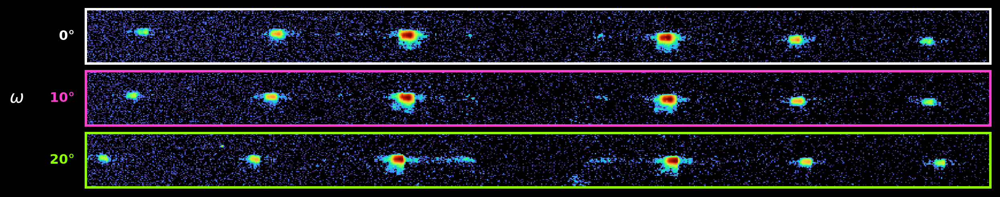
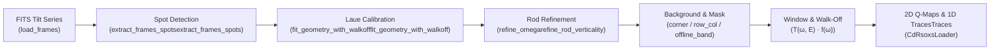

# Data reduction

Guide to reducing transmission CD-RSoXS and CD-SAXS CCD tilt series in `cd-reduce`: FITS frame loading, thin-strip spot detection, Laue geometry calibration, rod-verticality refinement, background subtraction (`corner`, `row_col`, `offline_band`, `strip_fit`), $\mathrm{Si_3N_4}$ window attenuation, and beam walk-off normalization.



## Contents

| Page | What it covers |
| --- | --- |
| [Spot extraction and calibration](calibration.md) | Thin detector strips (`extract_line_strip`, `plot_detector_strips`), spot detection (`extract_frame_spots`), 1D Laue cone geometry fitting (`fit_geometry_with_walkoff`), rod-verticality refinement (`refine_omega`), and indexed Bragg order tables (`build_order_table`) |
| [Backgrounds and corrections](backgrounds.md) | Corner dark offset, 2D row + cubic column ramp (`subtract_row_col_offset`), off-line $Q_y$ band (`subtract_offline_band_background`), per-strip fitting (`process_frame_strip`), $\mathrm{Si_3N_4}$ window transmission (`membrane_transmission`), walk-off (`walkoff_factor`), and template transfer (`extract_template_amplitudes`) |
| [Spot extraction and calibration](calibration.md) | Thin detector strips (`extract_line_strip`, `plot_detector_strips`), spot detection (`extract_frame_spots`), 1D Laue cone geometry fitting (`fit_geometry_with_walkoff`), rod-verticality refinement (`refine_rod_verticality`), and indexed Bragg order tables (`build_order_table`) |
| [Backgrounds and corrections](backgrounds.md) | Corner dark offset, 2D row + cubic column ramp (`subtract_row_col_offset`), off-line $Q_y$ band (`subtract_offline_band_background`), per-strip fitting (`process_frame_strip`), $\mathrm{Si_3N_4}$ window transmission (`membrane_transmission`), walk-off (`walkoff_factor`), and template transfer (`extract_template_amplitudes`) |

## Pipeline Overview



## High-Level `CdRsoxsLoader` Workflow

```python
import cd_reduce as cdr

loader = cdr.CdRsoxsLoader(
    "/path/to/sample_c_developedsample_c_developed",
    pitch_nm=8282.88,
    energy_ev=285.2,
    bg_mode="offline_bandoffline_band",
    apply_membrane=True,
    membrane_thickness_nm=100.0,
)

# Calibrate detector geometry and refine (omega0, , psi, Lambda), Lambda) for vertical rods
loader.calibrate(fit_walkoff=True)
loader.refine_rods()

# Build indexedindexed Bragg spot table,, 2D (Qx, Qz) map, and  (Qx, Qz) map, and 1D BraggBragg rodsrods
order_table = loader.build_order_table()
qmap = loader.to_qmap_2d("Qx", "Qz", approximation="correct")
rods = loader.extract_order_rods_qz(orders=(-4, -3, -2, -1, 1, 2, 3, 4))
```
