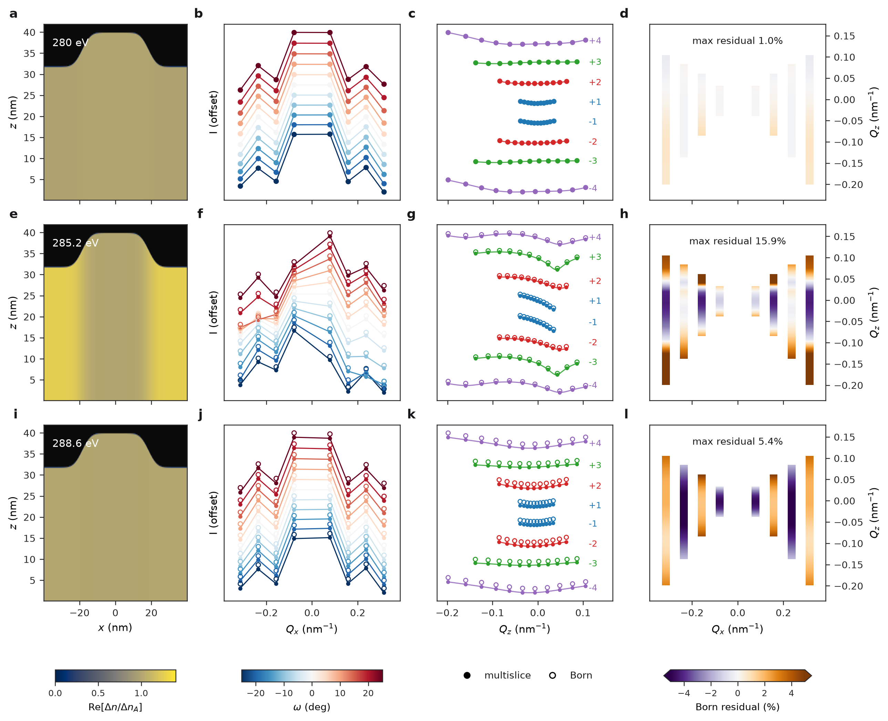

# 2D Born vs. Multislice

`cd-reduce` provides two 2D forward scattering solvers on identical [`RefractiveIndexMap2D`](../../api/python/simulation.md#cd_reduce.simulation.structures.RefractiveIndexMap2D) grids:

1. **2D Born Approximation** ([`simulate_born_2d`](../../api/python/simulation.md#cd_reduce.simulation.born.simulate_born_2d)): evaluates the kinematic Fourier transform of $\Delta n(x, z)$ along exact Ewald trajectories $Q_z(m, \omega)$.
2. **2D Split-Step Fourier Multislice** ([`simulate_multislice_2d`](../../api/python/simulation.md#cd_reduce.simulation.multislice.simulate_multislice_2d)): propagates the scalar wavefield slice-by-slice through the tilted optical map, capturing dynamical absorption, internal refraction, and Friedel symmetry breaking ($I_{+m}(\omega) \neq I_{-m}(\omega)$).



## Unravelling Kinematic vs. Dynamical Regimes Across the Absorption Edge

[`plot_born_vs_multislice_grid`](../../api/python/simulation.md#cd_reduce.simulation.visualization.plot_born_vs_multislice_grid) compares both solvers across photon energies on four aligned views — normalized cross-section $\mathrm{Re}[\Delta n(x, z)/\Delta n_A]$, $I$ vs. $Q_x$ per $\omega$, $I$ vs. $Q_z$ per order $+4 \dots -4$, and 2D Born shape residuals after global scale matching:

- **Pre-edge (`280 eV`, panels a–d)**: optical contrast and absorption are small ($\delta \sim 6.5 \times 10^{-4}$, $\beta \sim 1.4 \times 10^{-4}$) and nearly uniform inside the film. Born and Multislice agree to $\le 1.0\%$ across all orders and tilts.
- **Inhomogeneous resonance (`285.2 eV`, panels e–h)**: strong chemical contrast between unexposed core and outer exposed regions ($\mathrm{Re}[\Delta n/\Delta n_A] > 1.2$) combined with resonant absorption ($\beta \sim 2.6 \times 10^{-3}$) refracts and attenuates the internal wavefield asymmetrically with tilt $\omega$, producing large $Q_z$-dependent shape residuals up to $15.9\%$ (h) and skewing $I(Q_x;\,\omega)$ (f) and $I_m(Q_z)$ (g).
- **Continuum step (`288.6 eV`, panels i–l)**: chemical contrast between core and trench equalizes ($\Delta n_B / \Delta n_A \approx 1$), while strong continuum absorption ($\beta \sim 3.6 \times 10^{-3}$) damps the bottom of the film. Uniform depth attenuation mostly rescales overall intensity (panel k, open vs. filled circles), leaving smaller residual rod-shape curvature ($\sim 5.4\%$, panel l).

## Reproducing the Multi-Energy Comparison

```python
import numpy as np
from scipy.ndimage import gaussian_filter1d
import cd_reduce as cdr

nx, nz, pitch_nm, dz_nm = 320, 168, 80.0, 0.25
dx_nm = pitch_nm / nx
x_nm = (np.arange(nx) + 0.5) * dx_nm - 0.5 * pitch_nm
z_nm = (np.arange(nz) + 0.5) * dz_nm

# Smooth lateral exposure profile p(x) and surface shrinkage relief top(x)
raw_trench = (np.abs(x_nm) > 18.5).astype(float)
p_x = gaussian_filter1d(np.tile(raw_trench, 3), sigma=3.8 / dx_nm)[nx : 2 * nx]
top_x = 40.0 - 8.2 * p_x
occ_xz = np.clip((top_x[:, None] - z_nm[None, :]) / dz_nm + 0.5, 0.0, 1.0)

energy_models = [
    (280.0, 6.5e-4, 1.4e-4, 0.98 + 0.00j),
    (285.2, 1.75e-3, 2.55e-3, 1.26 - 0.26j),
    (288.6, 1.25e-3, 3.55e-3, 1.01 + 0.01j),
]

omegas = np.linspace(-25.0, 25.0, 101)
comparisons, dn_refs, tags = [], [], []
for energy_ev, delta_a, beta_a, ratio_ba in energy_models:
    dn_a = complex(delta_a, -beta_a)
    dn_xz = occ_xz * (dn_a * ((1.0 - p_x) + ratio_ba * p_x)[:, None])
    struct = cdr.RefractiveIndexMap2D(
        x_nm=x_nm,
        z_nm=z_nm,
        delta=np.real(dn_xz),
        beta=-np.imag(dn_xz),
        energy_ev=energy_ev,
        pitch_nm=pitch_nm,
    )
    born_res = cdr.simulate_born_2d(struct, omega_deg=omegas, max_order=4)
    ms_res = cdr.simulate_multislice_2d(struct, omega_deg=omegas, max_order=4)
    comparisons.append((born_res, ms_res))
    dn_refs.append(dn_a)
    tags.append(f"{energy_ev:g} eV")

fig, axes = cdr.plot_born_vs_multislice_grid(
    comparisons,
    orders=(4, 3, 2, 1, -1, -2, -3, -4),
    omega_samples_deg=np.linspace(-25.0, 25.0, 11),
    dn_ref_values=dn_refs,
    row_tags=tags,
    residual_lim_pct=5.0,
)
```
