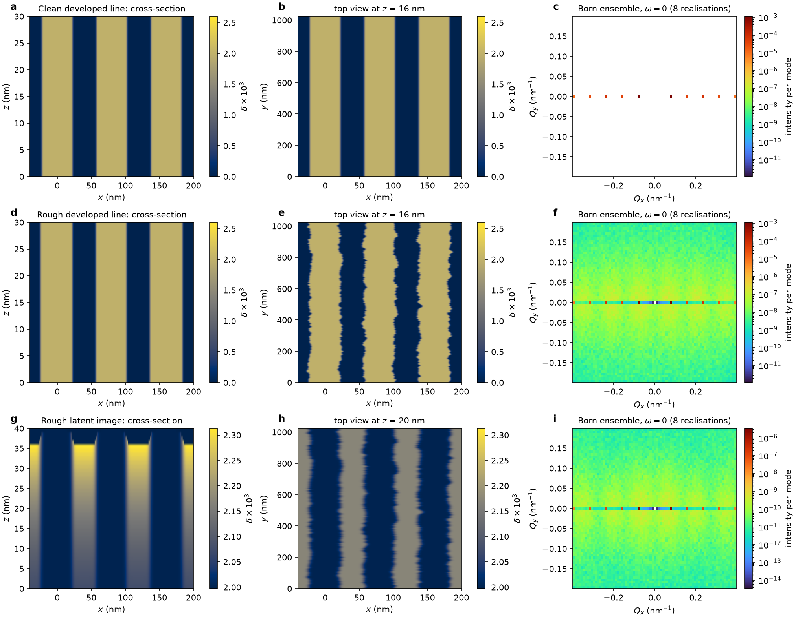

# 3D line gratings

[`RefractiveIndexMap3D`](../../api/python/simulation.md#cd_reduce.simulation.structures.RefractiveIndexMap3D) extends the optical-constant map to 3D $(x, y, z)$, with $x$ across the lines, $y$ along them and $z$ through the film. Any 2D cross section can be extruded into 3D and given rough edges, then simulated with the Born or the multislice engine.

The figure shows three gratings built from the same cross-section objects the roughness reduction uses:

- **a–c, clean developed line** (`DevelopedLine`, no roughness). The scattering is only the Bragg orders at $Q_y = 0$.
- **d–f, rough developed line.** The same line with independent placement (LPR) and width (LWR) roughness on every line. The orders lose intensity and the lost power appears as diffuse streaks along $Q_y$.
- **g–i, rough latent image** (`LatentFilm`). An undeveloped resist film: exposure decays from the top (chemical contrast, g) and the exposed regions shrink, leaving a shallow relief. The contrast is far weaker than for the developed line, so the scattering is several decades fainter (i).

Columns are the $(x, z)$ cross-section, the $(x, y)$ top view at mid-height, and the Born-ensemble intensity on the $(Q_x, Q_y)$ mode grid at $\omega = 0$ (log scale, zero order removed).



The figure is produced by `examples/simulation_3d_gratings.py`. The core of it:

```python
from functools import partial

import numpy as np
import cd_reduce as cdr

developed = cdr.DevelopedLine(
    L=80.0, w=45.0, s=1.0, h_d=30.0, dn_A=-2.0e-3 + 1.5e-3j, energy_ev=285.0
)
latent = cdr.LatentFilm(
    L=80.0, w=45.0, s=2.5, h=40.0, dh=4.0, lam=25.0,
    r=1.15 + 0.05j, dn_A=-2.0e-3 + 1.5e-3j, energy_ev=285.0,
)
psd_lpr = partial(cdr.psd_palasantzas, sigma_nm=1.5, xi_nm=25.0, hurst=0.7)
psd_lwr = partial(cdr.psd_palasantzas, sigma_nm=2.0, xi_nm=12.0, hurst=0.5)


def maker(xs, rough):
    def make(rng):
        return cdr.build_rough_grating_3d(
            xs, n_lines=8, ly_nm=1024.0, dx_nm=1.0, dy_nm=4.0, dz_nm=1.0,
            psd_lpr=psd_lpr if rough else None,
            psd_lwr=psd_lwr if rough else None,
            rng=rng,
        )
    return make


clean = cdr.simulate_rough_ensemble(maker(developed, False), [0.0], n_realisations=8)
rough = cdr.simulate_rough_ensemble(maker(developed, True), [0.0], n_realisations=8)
latent_res = cdr.simulate_rough_ensemble(maker(latent, True), [0.0], n_realisations=8)

# Detector-comparable intensity per mode: Bragg orders + diffuse
intensity = np.abs(rough.coherent[0]) ** 2 * rough.flux_factor[0] + rough.diffuse_flux[0]
```

Pass `engine="multislice"` to `simulate_rough_ensemble` to run the same structures through the multislice propagator instead (see [Ensembles of rough gratings](#ensembles-of-rough-gratings)).

## Edge roughness from two PSDs

Each line has a placement $P(y)$ and a width deviation $W(y)$. Its edges are $u_L = P - W/2$ and $u_R = P + W/2$. Both fields are drawn by `generate_edge_field` from two-sided PSD callables of $f = Q_y/2\pi$ ($\mathrm{nm^3}$ vs $\mathrm{nm^{-1}}$). Use `psd_lpr` and `psd_lwr`, or `None` for no roughness of that kind. The edge (LER) PSD is $S_{\mathrm{LPR}} + S_{\mathrm{LWR}}/4$. Independent edges of PSD $S_E$ correspond to `psd_lpr` $= S_E/2$ and `psd_lwr` $= 2S_E$.

```python
from functools import partial

import numpy as np
import cd_reduce as cdr

psd_lpr = partial(cdr.psd_palasantzas, sigma_nm=1.0, xi_nm=25.0, hurst=0.7)
psd_lwr = partial(cdr.psd_palasantzas, sigma_nm=1.5, xi_nm=12.0, hurst=0.5)

struct_3d = cdr.build_grating_3d(
    pitch_nm=80.0,
    cd_nm=38.0,
    thickness_nm=45.0,
    sidewall_angle_deg=88.0,
    delta_line=2.2e-3,
    beta_line=1.2e-3,
    psd_lpr=psd_lpr,
    psd_lwr=psd_lwr,
    nx=128,
    ny=96,
    nz=24,
    ly_nm=768.0,
    energy_ev=285.0,
    seed=17,
)
```

Arbitrary 3D `(delta, beta)` volumes can also be passed directly via [`RefractiveIndexMap3D.from_delta_beta`](../../api/python/simulation.md#cd_reduce.simulation.structures.RefractiveIndexMap3D.from_delta_beta).

## 3D Born and 3D multislice of one structure

[`simulate_born_3d`](../../api/python/simulation.md#cd_reduce.simulation.born.simulate_born_3d) and [`simulate_multislice_3d`](../../api/python/simulation.md#cd_reduce.simulation.multislice.simulate_multislice_3d) return the following for a single structure:

- the Bragg rods at $Q_y = 0$ (`bragg_rod(order)`, `order_efficiencies`);
- orthogonal `QMap2D` projections (`qmap_qx_qz`, `qmap_qx_qy`, `qmap_qy_qz`);
- the off-specular diffuse along $Q_y$ per order (`qy_grid`, `order_diffuse_qy[m]`).

```python
omegas = np.linspace(-24.0, 24.0, 17)
born_3d = cdr.simulate_born_3d(struct_3d, omega_deg=omegas, max_order=4, nqx=161, nqy=96, nqz=81)
ms_3d = cdr.simulate_multislice_3d(struct_3d, omega_deg=omegas, max_order=4, nqx=161, nqz=81)

qy, diffuse_m2 = born_3d.qy_grid, born_3d.order_diffuse_qy[2]
```

A single realisation is speckle. For quantitative diffuse, average an ensemble.

## Ensembles of rough gratings

`build_rough_grating_3d` builds a supercell of `n_lines` lines from any reduction cross section. Each line gets independent $P_j(y)$ and $W_j(y)$. The cell $\Delta n$ is the cross section's own profile, with the film surfaces filled by volume fraction, so the same object describes the sample in the simulation and in the reduction. The generated fields are kept in `metadata["P_nm"]` and `metadata["W_nm"]`.

`simulate_rough_ensemble` calls its `make_structure` argument with an independent random generator once per realisation and accumulates the coherent amplitude and the diffuse on the mode grid $(q_x, q_y)$ with the exact Ewald $Q_z$ of each mode:

```python
xs = cdr.LatentFilm(
    L=80.0, w=45.0, s=2.5, h=40.0, dh=4.0, lam=25.0,
    r=1.15 + 0.05j, dn_A=-2e-3 + 1.5e-3j, energy_ev=285.0,
)


def make(rng):
    return cdr.build_rough_grating_3d(
        xs, n_lines=16, ly_nm=2048.0, dx_nm=1.0, dy_nm=4.0, dz_nm=1.0,
        psd_lpr=psd_lpr, psd_lwr=psd_lwr, rng=rng,
    )


born = cdr.simulate_rough_ensemble(make, [-10.0, 0.0, 10.0], engine="born", n_realisations=8)
ms = cdr.simulate_rough_ensemble(
    make, [-10.0, 0.0, 10.0], engine="multislice", n_realisations=8,
    born_reference="epsilon",
)
```

The `RoughEnsembleResult` holds:

- `qx`, `qy`, `qz` and `valid` on the mode grid;
- `coherent`, the mean amplitude. Its orders carry the Debye–Waller loss: `order_efficiency(m)`, `order_qz(m)`;
- `diffuse`, the variance across realisations, with `diffuse_var`. Both are NaN for `n_realisations=1`, which is only for coherent-only work.

**Flux.** Detector flux carries $1/(\cos W\cos\theta_{\mathrm{out}})$, but amplitudes computed along the tilted path carry $1/\cos^2 W$. Use `diffuse_flux` and `order_flux_efficiency(m)`, which include the per-mode `flux_factor` $= \cos W/\cos\theta_{\mathrm{out}}$, whenever you compare with detector frames.

**Engines.** `engine` accepts exactly `"born"` or `"multislice"`:

- `"born"` is first-order kinematic scattering with no absorption.
- `"multislice"` propagates each realisation through the film, so it includes absorption, refraction and multiple scattering.

With `born_reference="epsilon"`, the multislice engine also propagates each realisation with $\Delta n$ scaled by `epsilon`, and stores the resulting first-Born diffuse in `metadata["born_eps"]`. Then `ms.diffuse / ms.metadata["born_eps"]` is free of speckle and isolates the non-kinematic effects. Compare it with the absorption factor $A$ of the reduction.

**Tilt sense.** The simulation's $\omega$ has the opposite sense to `cd_reduce.reduction.geometry`. A structure simulated at $\omega$ corresponds to a detector frame at $-\omega - \omega_0$.

These ensembles are what `tests/validation` renders into detector frames to test the roughness reduction (see [Roughness PSDs from diffuse scattering](../../theory/roughness_psd.md)).
