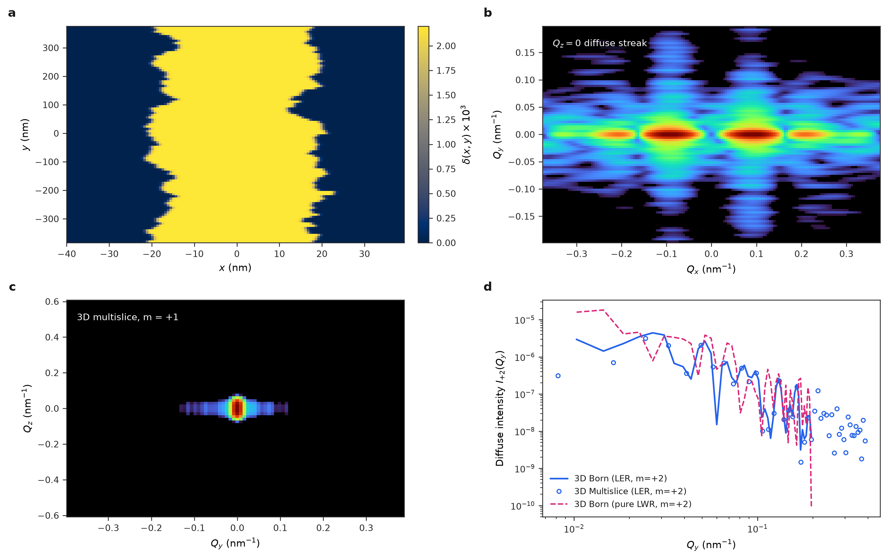

# 3D rough line gratings

[`RefractiveIndexMap3D`](../../api/python/simulation.md#cd_reduce.simulation.structures.RefractiveIndexMap3D) (aliased as `GratingStructure3D`) and [`build_grating_3d`](../../api/python/simulation.md#cd_reduce.simulation.structures.build_grating_3d) extend the optical constant map to 3D $(x, y, z)$, simulating **line-edge roughness (LER)**, **line-width roughness (LWR)**, and off-specular diffuse scattering in $(Q_x, Q_y, Q_z)$.



## Building a 3D Rough Grating (`build_grating_3d`)

`build_grating_3d` synthesizes left and right sidewall displacements $\Delta x_{L,R}(y)$ from a self-affine Palasantzas power spectral density parameterized by RMS edge roughness $\sigma_{\mathrm{LER}}$ (`ler_sigma_nm`), along-line correlation length $\xi_y$ (`correlation_length_y_nm`), Hurst exponent $H$ (`hurst_exponent`), and edge cross-correlation $c \in [-1, 1]$ (`roughness_correlation`, panel **a**):

```python
import numpy as np
import cd_reduce as cdr

struct_3d = cdr.build_grating_3d(
    pitch_nm=80.0,
    cd_nm=38.0,
    thickness_nm=45.0,
    sidewall_angle_deg=88.0,
    delta_line=2.2e-3,
    beta_line=1.2e-3,
    ler_sigma_nm=2.2,
    correlation_length_y_nm=28.0,
    hurst_exponent=0.75,
    roughness_correlation=0.0,  # -1: pure LWR, 0: uncorrelated, +1: pure LER
    nx=128,
    ny=96,
    nz=24,
    ly_nm=768.0,
    energy_ev=285.2,
    seed=17,
)
```

Arbitrary 3D `(delta, beta)` volumes can also be passed directly via [`RefractiveIndexMap3D.from_delta_beta`](../../api/python/simulation.md#cd_reduce.simulation.structures.RefractiveIndexMap3D.from_delta_beta).

## 3D Born vs. 3D Multislice and LER vs. LWR Symmetry

[`simulate_born_3d`](../../api/python/simulation.md#cd_reduce.simulation.born.simulate_born_3d) and [`simulate_multislice_3d`](../../api/python/simulation.md#cd_reduce.simulation.multislice.simulate_multislice_3d) return specular Bragg rods at $Q_y = 0$, orthogonal `QMap2D` projections (`qmap_qx_qz`, `qmap_qx_qy` in panel **b**, and `qmap_qy_qz` in panel **c**), and 1D off-specular diffuse profiles `diffuse_qy_trace(order=m)`:

- **Born vs. Multislice diffuse wings**: away from extreme absorption, 3D Born and 3D Multislice produce matching self-affine diffuse roll-offs along $Q_y$ (panel **d**, solid blue line vs. open circles).
- **LER vs. LWR order selection**: for a nearly symmetric half-pitch line ($w \approx \Lambda / 2$), anti-correlated width fluctuations ($c = -1$, pure LWR) enhance even-order diffuse sheets ($m = \pm 2$, dashed magenta curve) where correlated placement fluctuations ($c = +1$) cancel.

```python
omegas = np.linspace(-24.0, 24.0, 17)

born_3d = cdr.simulate_born_3d(
    struct_3d, omega_deg=omegas, max_order=4, nqx=161, nqy=96, nqz=81
)
ms_3d = cdr.simulate_multislice_3d(
    struct_3d, omega_deg=omegas, max_order=4, nqx=161, nqz=81
)

tr_born_m2 = born_3d.diffuse_qy_trace(order=2)
tr_ms_m2 = ms_3d.diffuse_qy_trace(order=2)
```
