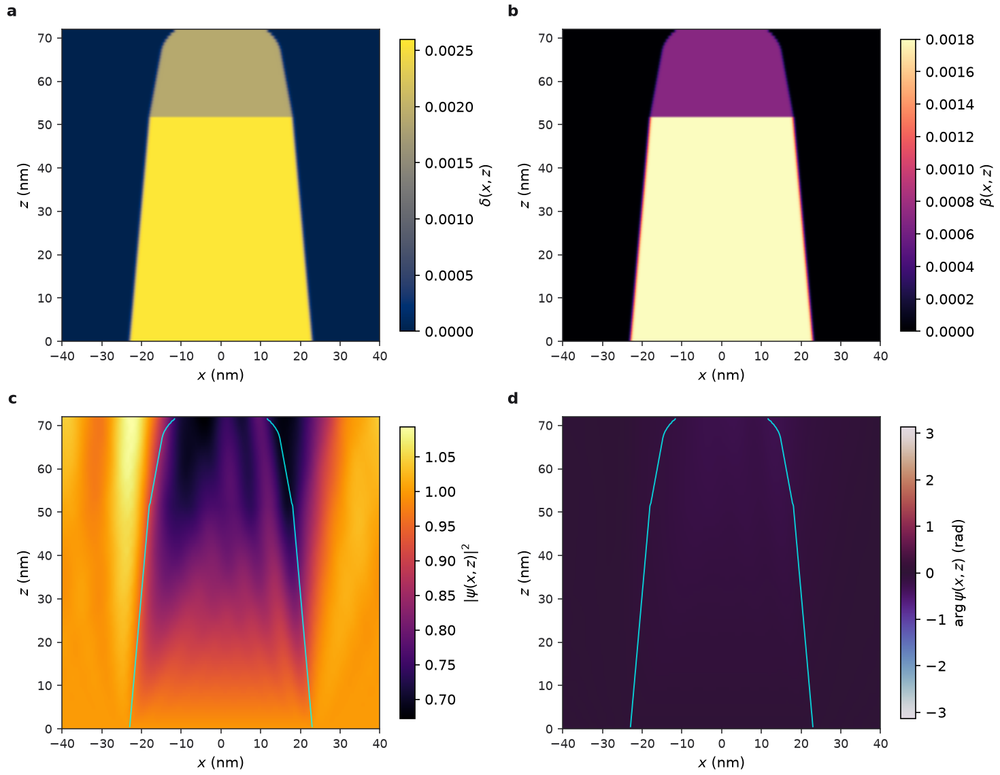

# 2D structures and wavefields

[`RefractiveIndexMap2D`](../../api/python/simulation.md#cd_reduce.simulation.structures.RefractiveIndexMap2D) (aliased as `GratingStructure2D`) represents any 2D periodic cross-section $n(x, z) = 1 - \delta(x, z) + i\beta(x, z)$ on a grid $(x_i, z_k)$ of pitch $\Lambda_x$ and height $L_z$.



## Parametric Multi-Layer Profiles (`build_grating_2d`)

[`build_grating_2d`](../../api/python/simulation.md#cd_reduce.simulation.structures.build_grating_2d) stacks one or more [`GratingLayerSpec`](../../api/python/simulation.md#cd_reduce.simulation.structures.GratingLayerSpec) layers with independent bottom/top CDs, sidewall angle, top corner rounding, lateral offset $x_0$, and interfacial blurring (panels **a–b**):

```python
import numpy as np
import cd_reduce as cdr

layers = [
    cdr.GratingLayerSpec(
        thickness_nm=52.0,
        cd_bottom_nm=46.0,
        cd_top_nm=36.0,
        delta_line=2.6e-3,
        beta_line=1.8e-3,
    ),
    cdr.GratingLayerSpec(
        thickness_nm=20.0,
        cd_bottom_nm=36.0,
        cd_top_nm=28.0,
        top_rounding_nm=5.0,
        delta_line=1.9e-3,
        beta_line=7.0e-4,
    ),
]

struct_2d = cdr.build_grating_2d(
    pitch_nm=80.0,
    layers=layers,
    nx=256,
    nz=96,
    energy_ev=285.2,
)
```

## Arbitrary Custom 2D Optical Constant Maps

Any user-supplied `(delta, beta)` arrays — such as reaction-diffusion resist profiles, finite-element shrink models, or electron tomography reconstructions — can be passed directly to [`RefractiveIndexMap2D.from_delta_beta`](../../api/python/simulation.md#cd_reduce.simulation.structures.RefractiveIndexMap2D.from_delta_beta):

```python
nx, nz = 256, 80
x_nm = np.linspace(-40.0, 40.0, nx, endpoint=False)
z_nm = np.linspace(0.5, 79.5, nz)
xx, zz = np.meshgrid(x_nm, z_nm, indexing="ij")

in_outer = np.abs(xx) <= (22.0 - 0.05 * zz)
in_core = (np.abs(xx) <= (16.0 - 0.05 * zz)) & (zz <= 68.0)

delta_map = np.where(in_core, 2.8e-3, np.where(in_outer, 1.4e-3, 0.0))
beta_map = np.where(in_core, 9.0e-4, np.where(in_outer, 3.0e-4, 0.0))

custom_2d = cdr.RefractiveIndexMap2D.from_delta_beta(
    delta=delta_map,
    beta=beta_map,
    pitch_nm=80.0,
    thickness_nm=80.0,
    energy_ev=285.2,
)
```

## Visualizing Optical Maps and Internal Multislice Wavefields

[`plot_structure_2d`](../../api/python/simulation.md#cd_reduce.simulation.visualization.plot_structure_2d) and [`plot_multislice_wavefield`](../../api/python/simulation.md#cd_reduce.simulation.visualization.plot_multislice_wavefield) plot $\delta(x, z)$, $\beta(x, z)$, and the internal complex wavefield $\psi(x, z)$ at any chosen sample tilt `field_omega_deg` (panels **c–d**, showing sidewall channelling and depth attenuation at $\omega = +8^\circ$):

```python
ms_wf = cdr.simulate_multislice_2d(
    struct_2d,
    omega_deg=np.linspace(-25.0, 25.0, 51),
    max_order=4,
    field_omega_deg=8.0,
)

cdr.plot_structure_2d(struct_2d, component="both", panel_labels=("a", "b"))
cdr.plot_multislice_wavefield(ms_wf, overlay_structure=True, panel_labels=("c", "d"))
```
