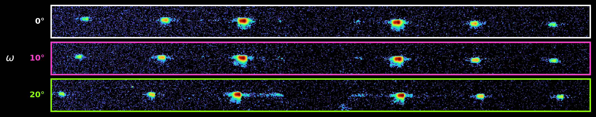

# cd-reduce

Transmission CD-RSoXS and CD-SAXS data reduction, reciprocal-space mapping, and 2D/3D Born & multislice scattering simulation for Beamline 11.0.1.2 at the Advanced Light Source.



## Installation

```bash
pip install cd-reduce
```

With `uv` (recommended):

```bash
uv add cd-reduce
```

## Quick Start

```python
import numpy as np
import cd_reduce as cdr

# 1. Build a 2D grating refractive index map n(x, z) = 1 - delta(x, z) + i*beta(x, z)
struct_2d = cdr.build_grating_2d(
    pitch_nm=80.0,
    cd_nm=38.0,
    thickness_nm=45.0,
    sidewall_angle_deg=87.0,
    delta_line=1.8e-3,
    beta_line=2.5e-3,
    energy_ev=285.2,
)

# 2. Simulate Born and Split-Step Fourier Multislice diffraction
omegas = np.linspace(-25.0, 25.0, 51)
born_2d = cdr.simulate_born_2d(struct_2d, omega_deg=omegas, max_order=4)
ms_2d = cdr.simulate_multislice_2d(struct_2d, omega_deg=omegas, max_order=4)

# 3. Reduce an experimental FITS tilt series via CdRsoxsLoader
# loader = cdr.CdRsoxsLoader("/path/to/sample_c_developed", pitch_nm=82.8, energy_ev=285.2)
# loader.calibrate(fit_walkoff=True)
# loader.refine_rods()
# qmap_qx_qz = loader.to_qmap_2d("Qx", "Qz", approximation="correct")
# ridges_by_omega = loader.extract_qx_by_omega()
# rods_by_order = loader.extract_order_rods_qz(orders=(-4, -3, -2, -1, 1, 2, 3, 4))
```

## Documentation Sections

| Section | Description |
| --- | --- |
| [Data reduction](guides/reduction/index.md) | FITS loading, thin-strip spot detection, Laue geometry calibration, rod-verticality refinement, background subtraction, $\mathrm{Si_3N_4}$ transmission, and beam walk-off |
| [Reciprocal-space mapping](guides/mapping/index.md) | 2D $I$ vs. $Q$ projections across `(Qx, Qz)`, `(Qx, Qy)`, `(Qy, Qz)`, `(Qr, Qz)`, `(signed_Qr, Qz)`, exact vs. small-angle Ewald geometry, specular 1D ridges $I(Q_x;\omega)$ & Bragg rods $I_m(Q_z)$, and off-specular diffuse cuts & Born LER PSD |
| [Building and simulating structures](guides/simulation/index.md) | General 2D & 3D optical constant maps $\delta(\mathbf{r}) + i\beta(\mathbf{r})$, Born vs. Split-Step Fourier Multislice comparison, internal wavefields, and 3D rough line gratings |
| [Theory](theory/overview.md) | 3D Ewald sphere geometry, kinematic Born form-factor and Palasantzas roughness PSD equations, and paraxial Split-Step Fourier Multislice propagation |
| [API Reference](api/index.md) | Auto-generated Python API reference for `cd_reduce`, `cd_reduce.loader`, `cd_reduce.reduction`, and `cd_reduce.simulation` |

## Team and support

- ALS-REIXS team: [RIXS Program at ALS](https://als.lbl.gov/science/photon-science-programs/rixs-program/)
- Group GitHub: [ALS-RSOXS organization](https://github.com/ALS-RSOXS)
- Submit issues: [cd-reduce issue tracker](https://github.com/ALS-RSOXS/cd-reduce/issues)

## Development

### Setup

```bash
git clone https://github.com/als-rsoxs/cd-reduce.git
cd cd-reduce
uv sync --all-groups
```

### Verification

```bash
uv run pytest
uv run ruff check .
uv run ruff format --check .
uv run ty check
```

## License

MIT License — see [LICENSE](https://github.com/als-rsoxs/cd-reduce/blob/main/LICENSE).
