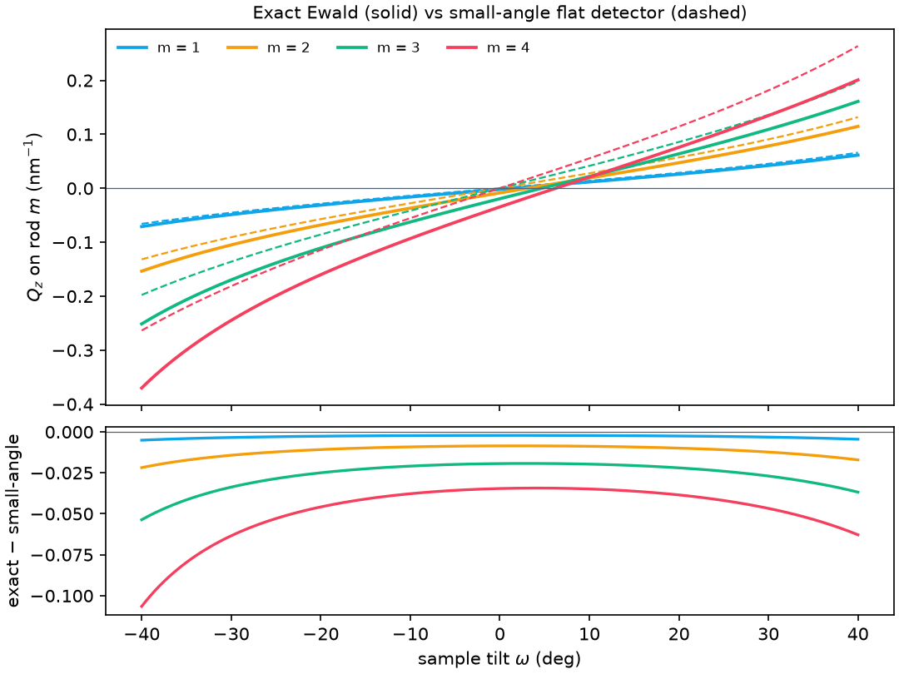

---
extra_javascript:
  - javascripts/ewald-figure.js
extra_css:
  - stylesheets/ewald-figure.css
---

# Ewald sphere and geometry

A detector frame records the scattering that satisfies elastic scattering, $|\mathbf{k}_i + \mathbf{Q}| = |\mathbf{k}_i|$: every pixel sees one point on the Ewald sphere of radius $k = 2\pi/\lambda$, which passes through the origin of reciprocal space. A line grating scatters only onto rods at $Q_x = mG$ ($G = 2\pi/\Lambda$), so each frame samples each rod at one $Q_z$. Tilting the sample by $\omega$ tilts the sphere relative to the rods and slides those points along them; a sweep of $\omega$ traces out the $(Q_x, Q_z)$ "butterfly" that the reduction maps.

  

In the sample frame the sphere's centre is $\mathbf{C} = (k\sin\omega,\, 0,\, -k\cos\omega)$, and rod $m$ meets it at

$$
Q_z(m, \omega) = -k\cos\omega + \sqrt{k^2 - (mG - k\sin\omega)^2},
$$

with no intersection when the root is imaginary. For small $mG/k$ this is $Q_z \approx mG\tan\omega - (mG)^2/(2k\cos\omega)$: the flat-detector term plus the Ewald curvature. The figure evaluates this closed form; `tests/test_ewald_fixtures.py` checks it against [`compute_pixel_q`](../api/python/reduction.md#cd_reduce.reduction.geometry.compute_pixel_q) to $10^{-9}\,\mathrm{nm^{-1}}$.

## 3D Detector-to-Sample Ewald Transformation

For a detector pixel $(x_{\mathrm{px}}, y_{\mathrm{px}})$, the displacement from the direct-beam center $(u_0, v_0)$ (plus any per-frame walk-off shift $\Delta v_f$) is rotated in the detector plane by the line-rotation angle $\theta_{\mathrm{line}}$:

$$
\begin{pmatrix} d_u \\ d_v \end{pmatrix} =
\begin{pmatrix} \cos\theta_{\mathrm{line}} & \sin\theta_{\mathrm{line}} \\ -\sin\theta_{\mathrm{line}} & \cos\theta_{\mathrm{line}} \end{pmatrix}
\begin{pmatrix} x_{\mathrm{px}} - u_0 \\ y_{\mathrm{px}} - (v_0 + \Delta v_f) \end{pmatrix}
$$

Accounting for detector tilt $\beta$ about the lab horizontal axis and sample-to-detector distance $L_b$ (in pixels), the 3D pixel position in the lab frame is:

$$
\mathbf{r}_{\mathrm{px}} = \begin{pmatrix} d_u \\ d_v \cos\beta \\ L_b - d_v \sin\beta \end{pmatrix}, \qquad \hat{\mathbf{s}} = \frac{\mathbf{r}_{\mathrm{px}}}{|\mathbf{r}_{\mathrm{px}}|}
$$

With incident wavevector $\mathbf{k}_i = (0, 0, k_0)$ where $k_0 = 2\pi / \lambda(E)$, the exact laboratory scattering vector on the Ewald sphere (`approximation="correct"`) is:

$$
\mathbf{Q}_{\mathrm{lab}} = k_0(\hat{\mathbf{s}} - \hat{\mathbf{z}}) = k_0 \begin{pmatrix} \hat{s}_u \\ \hat{s}_v \\ \hat{s}_z - 1 \end{pmatrix}
$$

Rotating from the lab frame into the sample frame via sample tilt $\omega_{\mathrm{eff}} = \omega + \omega_0$ (`Geometry.omega0_deg`) about the lab $u$-axis ($R_x(-\omega_{\mathrm{eff}})$) and grating in-plane azimuth $\psi$ about the sample normal ($R_z(-\psi)$) gives:

$$
\begin{pmatrix} Q_y \\ Q_x \\ Q_z \end{pmatrix} = R_z(-\psi)\,R_x(-\omega_{\mathrm{eff}})\,\mathbf{Q}_{\mathrm{lab}}
$$

## Small-Angle Flat-Detector Approximation

In the small-angle limit (`approximation="small_angle"`), $|\mathbf{r}_{\mathrm{px}}| \approx L_b$, $\hat{s}_z - 1 \approx 0$, and $\psi \approx 0$:

$$
Q_{\mathrm{lab},u} \approx k_0 \frac{d_u}{L_b}, \qquad Q_{\mathrm{lab},v} \approx k_0 \frac{d_v}{L_b}, \qquad Q_{\mathrm{lab},z} \approx 0
$$

so the sample-frame coordinates reduce to:

$$
Q_x \approx Q_{\mathrm{lab},v}\cos\omega_{\mathrm{eff}}, \qquad Q_y \approx Q_{\mathrm{lab},u}, \qquad Q_z \approx Q_{\mathrm{lab},v}\sin\omega_{\mathrm{eff}} = Q_x \tan\omega_{\mathrm{eff}}
$$

Along each rod this drops the Ewald curvature term $-(mG)^2/(2k\cos\omega)$, so the small-angle $Q_z$ is offset from the exact one even at $\omega = 0$, and the offset grows with order and tilt:

## Radial and Angular Coordinates

From $(Q_x, Q_y, Q_z)$ and $\hat{\mathbf{s}}$, [`compute_pixel_q`](../api/python/reduction.md#cd_reduce.reduction.geometry.compute_pixel_q) evaluates:

$$
Q_r = \sqrt{Q_x^2 + Q_y^2}, \qquad \mathrm{signed}\ Q_r = \operatorname{sgn}(Q_x)\,Q_r, \qquad |\mathbf{Q}| = \sqrt{Q_x^2 + Q_y^2 + Q_z^2}, \qquad 2\theta = \arccos(\hat{s}_z)
$$

## Solid-Angle, Polarization, Attenuation, and Walk-Off

### Planar detector solid-angle Jacobian

$$
C_{\Omega}(2\theta) = \cos^3(2\theta)
$$

### Thomson polarization factor

$$
C_{\mathrm{pol}} = \begin{cases}
1 - \hat{s}_u^2 & \text{horizontal }(s)\text{ polarization} \\
1 - \hat{s}_v^2 & \text{vertical }(p)\text{ polarization} \\
1 - \tfrac{1}{2}(\hat{s}_u^2 + \hat{s}_v^2) & \text{unpolarized}
\end{cases}
$$

### $\mathrm{Si_3N_4}$ membrane transmission

$$
T(\omega, E) = \exp\!\left(-\frac{\mu_{\mathrm{Si_3N_4}}(E)\,t_{\mathrm{Si_3N_4}}}{\cos\omega}\right)
$$

### Gaussian beam walk-off

$$
f(\omega; a, b) = \Phi(a - b\tan\omega) = \frac{1}{2}\left[1 + \operatorname{erf}\!\left(\frac{a - b\tan\omega}{\sqrt{2}}\right)\right]
$$
